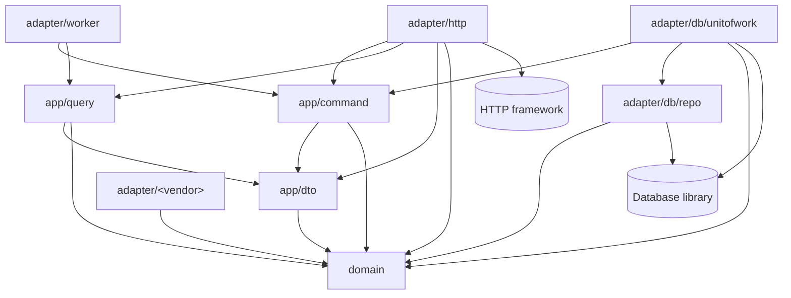

# Architecture

The reference structure of a service. A project may have one service or many;
each keeps these rules or records its own in a reviewed change. The examples
use the `book` domain of the
[reference pass](../software-knowledges/README.md). The
[domain map](domain-map.md) says which service serves each domain.

## Direction

- Each service is one deployable, split by domain inside it, with its own
  database. A service never reads another service's database; it calls the
  other service's operations, through their contract.
- Inside a service: no module walls or events between domains, and a flow may
  cross several of its domains in one transaction. Between services: no
  shared transaction; a call or a published message after the transaction,
  retried or compensated when it fails, and safe to receive twice.
- Commands and queries take separate paths (light CQRS): a command changes
  state through the domain, a query only reads. Both use the same database and
  the same transactions. There is no separate read store, and no events inside
  a service.
- Handlers return transfer objects, never database models.
- External systems, such as payment providers, storage, email and push, sit
  behind interfaces, so they can be faked in tests and their failures handled
  in one place.
- Code that predates this structure lives next to it and moves in use case by
  use case.

## Layout and dependency rules

```
internal/
  domain/                 # one package per domain in the domain map
  app/
    command/              # use cases that change state
    query/                # use cases that only read
    dto/                  # data transfer objects
  adapter/
    http/                 # HTTP handlers
    worker/               # entry points called by timers, schedules and queues
    db/
      repo/               # implementations of the domain Writer and Reader interfaces
      unitofwork/         # implementation of the command UnitOfWork
    <vendor>/             # one external system each
    <service>/            # client of another service's operations
```

| Package | Holds | May import |
| --- | --- | --- |
| `domain/<name>` | Entities, business rules, and the `<Entity>Writer` and `<Entity>Reader` interfaces | Other domain packages, standard library |
| `app/command` | Use cases that change state, `UnitOfWork` and `TransactionalUnitOfWork` | Domain, `app/dto` |
| `app/query` | Use cases that only read | Domain, `app/dto` |
| `app/dto` | Data transfer objects | Domain |
| `adapter/http` | HTTP handlers | `app/command`, `app/query`, `app/dto`, domain |
| `adapter/worker` | Entry points called by timers, schedules and queues; each calls one command or query, as a handler does | `app/command`, `app/query`, `app/dto`, domain |
| `adapter/db/repo` | Database models and the repositories | Domain, the database library |
| `adapter/db/unitofwork` | The transaction and the writers bound to it | `adapter/db/repo`, `app/command`, domain, the database library |
| `adapter/<vendor>` | One external system behind an interface | Domain, the vendor SDK |
| `adapter/<service>` | Calls to another service's operations, behind an interface, from that service's contract | Domain, the HTTP client |
| `adapter/<broker>` | Publishing messages to a queue or a topic, behind an interface, from the publishing flow's contract | Domain, the broker SDK |

The same rules as a diagram; an arrow means "imports":



Rules:

- Domain packages import no database library and no HTTP framework.
- A use case may call any domain it needs. Calling across domains is a plain
  function call.
- Database models never leave `adapter/db/repo`. Request transfer objects are
  mapped explicitly and are never turned into column maps by reflection.
- Provider calls and calls to other services stay outside database
  transactions.

Domains are a way to find code, not a boundary to enforce inside a service. If
a group of use cases later changes together and rarely touches the rest, it
can move to its own service then, based on real code, with a change to the
domain map.

## Contents

- [Entities](entities.md): how a domain entity is written.
- [Commands and queries](commands-and-queries.md): the two paths of the
  application layer, and transfer objects.
- [Repositories and unit of work](repositories.md): how commands and queries
  reach the database, and how a command runs in one transaction.
- [Decisions](decisions.md): why the knowledge and the code are shaped this
  way, and what each choice costs.
- [Domain map](domain-map.md): the domains, and the existing code that moves
  into each one.

Return to [documentation](../README.md).
