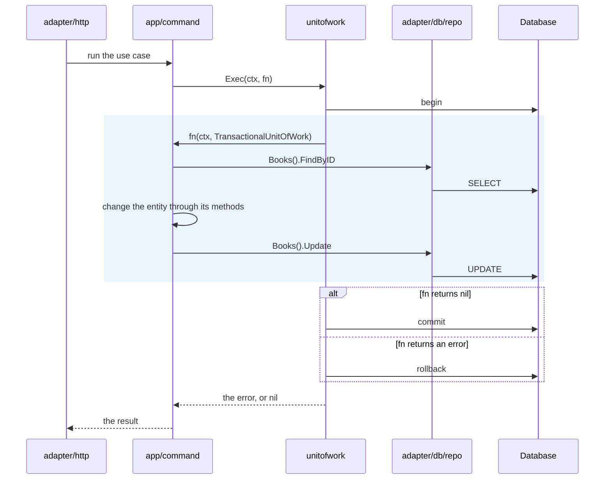

# Repositories and unit of work

How commands and queries reach the database. The examples use the `book`
domain of the [reference pass](../software-knowledges/artifacts/book/service.md).

## Naming

| Thing | Rule | Example |
| --- | --- | --- |
| Repository interfaces | `<Entity>Writer` and `<Entity>Reader`, in the domain's `repository.go` | `book.BookWriter` |
| Repository type | Plural of the entity, unexported | `books` |
| Repository constructor | `New` and the plural | `repo.NewBooks(db)` |
| Repository file | snake_case of the plural | `adapter/db/repo/books.go` |
| GORM model | The entity and `Row`, unexported | `bookRow` |

## Repositories

- Each domain declares its repository interfaces, split into a writer and a
  reader: domain `book` has `BookWriter` and `BookReader`.
- A `Reader` returns domain entities. The query maps them to transfer objects.
- A `Writer` may also read, but only to load what a command is about to change
  inside its transaction. Most reads there need no lock; add a locking read,
  such as `FindByIDForUpdate`, only when the use case needs one.
- `adapter/db/repo` holds the implementations, named as in
  [Naming](#naming). A compile-time check binds each one to its interfaces:

  ```go
  var (
      _ book.BookWriter = (*books)(nil)
      _ book.BookReader = (*books)(nil)
  )
  ```

- A repository maps between its GORM model and the entity in two functions:
  `toBookRow` reads the entity through its methods, and `toBook`
  rebuilds it with `Restore`. It never touches entity fields.
- A repository turns `gorm.ErrRecordNotFound` into the domain's `ErrNotFound`,
  so callers never see GORM errors they must recognise.
- `Update` writes only the columns the entity owns, listed with `Select`.

## Unit of work

A command runs its writes, across any number of domains, in one transaction:

- `app/command` declares `UnitOfWork`, with
  `Exec(ctx, func(ctx, TransactionalUnitOfWork) error) error`, and
  `TransactionalUnitOfWork`, which returns one writer per domain, such as
  `Books() book.BookWriter`.
- `adapter/db/unitofwork` implements both. `Exec` commits when the function
  returns nil and rolls back when it returns an error. Every writer it hands
  out is a repository built on that transaction, such as
  `repo.NewBooks(tx)`.
- A new domain writer is added in three places: a method on
  `TransactionalUnitOfWork`, its implementation in `adapter/db/unitofwork`,
  and the repository in `adapter/db/repo`.
- A command gets its writers only from `TransactionalUnitOfWork`, never by
  building a repository itself.
- Provider calls stay outside `Exec`.

How a command reaches the database in one transaction:



Return to [architecture](README.md).
