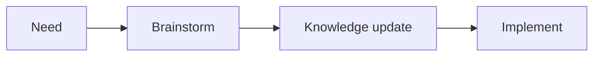
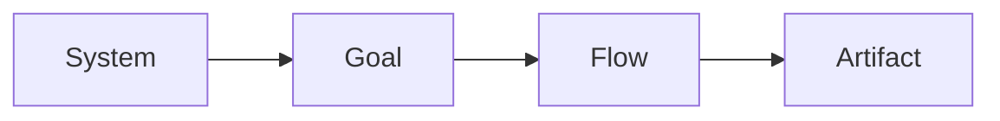

# Develop with agents

Open the agent at the root of this workspace. It reads [AGENTS.md](../../../AGENTS.md).

## 1. From need to code



| Step | Does |
| --- | --- |
| Brainstorm | Gathers the new need and the existing flows and rules it touches, lays out the options, and asks about the one chosen. |
| Knowledge update | Writes the chosen option into the knowledge, and runs the checks ([workflow](workflow.md)): the goal and its `flowchart`; the flows, their scenarios and `sequenceDiagram`; each artifact's specification, its rules, `classDiagram` and `stateDiagram-v2`; the OpenAPI contracts. |
| Implement | Changes the code of each part from the updated knowledge; its tests name the IDs they prove ([Done](done.md)). |

## 2. Read the knowledge, top down



| Layer | Holds | Find it |
| --- | --- | --- |
| System | Rules for everything, actors, services, clients; shared in and out: errors, authentication | [system](../../software-knowledges/system/README.md) |
| Goal | What is needed, and how you know it is done: the criteria | [goals](../../software-knowledges/goals/README.md) |
| Flow | The interaction: who starts it, the steps in order, what happens on failure, the scenarios. In and out across domains: endpoints, payloads, triggers. Rules across domains: Flow rules | The flows the goal lists |
| Artifact | The domain spec: model, rules, lifecycle, in `specification.md`. Its in and out: `openapi.yaml` | `artifacts/<artifact>/specification.md` of each artifact the flow crosses |

The knowledge site shows the layers and the system diagram, then, for the
goals you analyze, the story of each goal (its flows, rules and artifacts) and
the diagrams. Build and open it from the workspace root
([knowledge site](../../../scripts/README.md#knowledge-site)):

```sh
python3 scripts/site.py
open build/site/index.html    # Linux: xdg-open
```

Return to [Artifact Driven](README.md).
