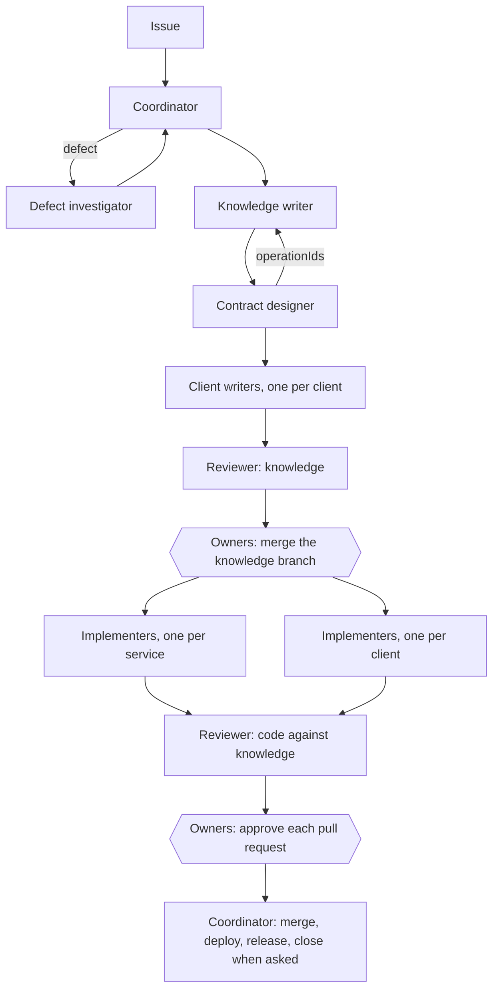

# Team

Who does each step of the [workflow](workflow.md). The whole team builds the
product, and each part of it has an owner. A role can be a person or an AI
agent; the agent definitions are in
[agent team](../../../.agents/agents/README.md). One person or agent may hold
several roles, but the reviewer is never the author of the change it reviews.

## Parts and owners

A part is one thing the team builds and releases on its own: a service, a
client, or the shared knowledge. Each part has an owner, a person or a group of
people on the team, named in the README that lists the part
([services](../../../services/README.md), [clients](../../../apps/README.md)).

| Part | Who keeps it | Who approves a change to it |
| --- | --- | --- |
| Knowledge: system, goals and flows | The whole team; the product owner decides on goals | The product owner for a goal; the owners of the services a flow crosses for a flow; the whole team for the system |
| An artifact: specification, contract, service page | The owner of the service that serves it | That owner |
| A client page | The owner of that client | That owner; the owner of the serving service is told on the issue, because a new need binds the service (SYS-4) |
| A service: code, tests, deploy | Its owner | Its owner |
| A client: code, tests, release | Its owner | Its owner |
| Shared contract components (`system/openapi.yaml`) | The owners of the services | Every service owner, because every service follows them |
| The API gateway: which service serves each operation | Its owner, named in [Contributing](../../../CONTRIBUTING.md#owners) | Its owner, with the owners of the services it routes to |
| End-to-end tests | The quality owner, named in [Contributing](../../../CONTRIBUTING.md#owners) | The quality owner |

A change that touches several parts needs the approval of each part's owner,
for that part only.

When owners disagree, the product owner decides what a goal needs, and the
owner of each part decides how that part does it. When that does not settle
it, the tie-breaker named in [Contributing](../../../CONTRIBUTING.md#owners)
decides. The decision and its reasons go on the issue.

## Roles

| Role | Does | Skill | Writes |
| --- | --- | --- | --- |
| Coordinator | Takes the issue, hands each step to its role, gathers results, asks the owners for decisions, commits and opens pull requests when asked | — | Commits and pull requests |
| Knowledge writer | Goals, flows and artifact rules | `software-knowledge` | Knowledge pages, not contracts |
| Contract designer | OpenAPI contracts, before the code | `software-knowledge` | Contracts |
| Client writer | What one client needs from the responses. The client's owner writes it, or an analyst who reads the client's code writes it and the owner reviews it | `software-knowledge` | Client pages |
| Implementer | Code and tests of one part from approved knowledge | The skill of the part's stack, such as `backend-service` | The part's code, on its own branch |
| Defect investigator | Evidence for a reported defect and the ID it breaks | `defect-triage` | Nothing; reports |
| Reviewer | Knowledge, contract, code and tests agree; [Done](done.md) holds | `software-knowledge` | Nothing; reports |
| Approvers | The owner of each part the change touches: approves knowledge by merging its branch, and code by approving its pull request | — | Merges and approvals |

## Flow

| Workflow step | Roles |
| --- | --- |
| 1. Issue | Coordinator; defect investigator for a defect |
| 2. Knowledge | Knowledge writer, contract designer, client writers, reviewer, owners |
| 3. Code | One implementer per part the change touches, reviewer, owners |
| 4. Merge, deploy and release | Coordinator, when the owners ask |
| 5. Close | Coordinator, when [Done](done.md) holds |

## Passing work

- A role skips its step when the change does not need it: no endpoint,
  payload or trigger, no contract designer; no client receives a response or
  a payload, no client writer; a part the change does not touch, no
  implementer.
- Client writers run in parallel, one per client. Implementers run in
  parallel, one per part, each in the repository of its part.
- Each issue has one coordinator and one knowledge branch. When several issues
  are in progress, the owners of the parts they touch order the merges
  ([parallel branches](workflow.md#parallel-branches)).
- Each role reports to the coordinator: what changed, the IDs, the check
  results and the open questions. The next role starts from that report and
  the merged or proposed pages, not from memory.
- A role that hits something outside its scope or tools hands it back to the
  coordinator instead of working around it.
- A knowledge gap found during code goes back to the knowledge writer; no
  implementer invents behavior.

## Limits

- Only the coordinator commits, pushes, opens pull requests, merges code pull
  requests, deploys or releases, and only when the owner of that part asks.
  Only the owners of the parts a knowledge branch touches merge it.
- A role changes only the parts its owner gave it. When the people doing a
  change have no access to a part's repository, they write a handoff to that
  part's owner on the issue, citing the knowledge.
- The defect investigator and the reviewer change nothing.

Return to [Artifact Driven](README.md).
