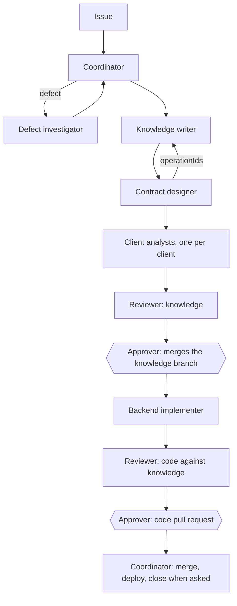

# Team

Who does each step of the [workflow](workflow.md). Every role except the
approver is an AI agent; the agent definitions are in
[agent team](../../../.agents/agents/README.md). The approvers are the people in
the loop: one person or a whole team, and any of them may approve. One agent may hold several roles, but the reviewer is never the
author of the change it reviews.

## Roles

| Role | Does | Skill | Writes |
| --- | --- | --- | --- |
| Coordinator | Takes the issue, hands each step to its role, gathers results, asks the approver for decisions, commits and opens pull requests when asked | — | Commits and pull requests |
| Knowledge writer | Goals, flows and artifact rules | `software-knowledge` | Knowledge pages, not contracts |
| Contract designer | OpenAPI contracts, before the code | `software-knowledge` | Contracts |
| Client analyst | What each client needs from an artifact's responses; briefs and handoffs to the app team | `software-knowledge` | Client pages; reads the clients only |
| Backend implementer | Code and tests from approved knowledge | `backend-service` | Backend code, on its own branch |
| Defect investigator | Evidence for a reported defect and the ID it breaks | `defect-triage` | Nothing; reports |
| Reviewer | Knowledge, contract, code and tests agree; [Done](done.md) holds | `software-knowledge` | Nothing; reports |
| Approver (a person on the team) | Approves knowledge by merging its branch, and code by approving its pull request | — | Merges into the knowledge default branch; approvals |

## Flow

| Workflow step | Roles |
| --- | --- |
| 1. Issue | Coordinator; defect investigator for a defect |
| 2. Knowledge | Knowledge writer, contract designer, client analysts, reviewer, approver |
| 3. Code | Backend implementer, reviewer, approver |
| 4. Merge and deploy | Coordinator, when the approver asks |
| 5. Close | Coordinator, when [Done](done.md) holds |

## Handoffs

- A role skips its step when the change does not need it: no endpoint,
  payload or trigger, no contract designer; no client receives a response or
  a payload, no client analyst.
- Client analysts run in parallel, one per client.
- Each issue has one coordinator and one branch. When several issues are in
  progress, the approver orders the merges
  ([parallel branches](workflow.md#parallel-branches)).
- Each role reports to the coordinator: what changed, the IDs, the check
  results and the open questions. The next role starts from that report and
  the merged or proposed pages, not from memory.
- A role that hits something outside its scope or tools hands it back to the
  coordinator instead of working around it.
- A knowledge gap found during code goes back to the knowledge writer; the
  implementer does not invent behavior.

## Limits

- Only the coordinator commits, pushes, opens pull requests, merges code pull
  requests or deploys, and only when the approver asks. Only the approver
  merges a knowledge branch into the default branch.
- Nobody commits to the client repositories.
- The defect investigator and the reviewer change nothing.

Return to [Artifact Driven](README.md).
