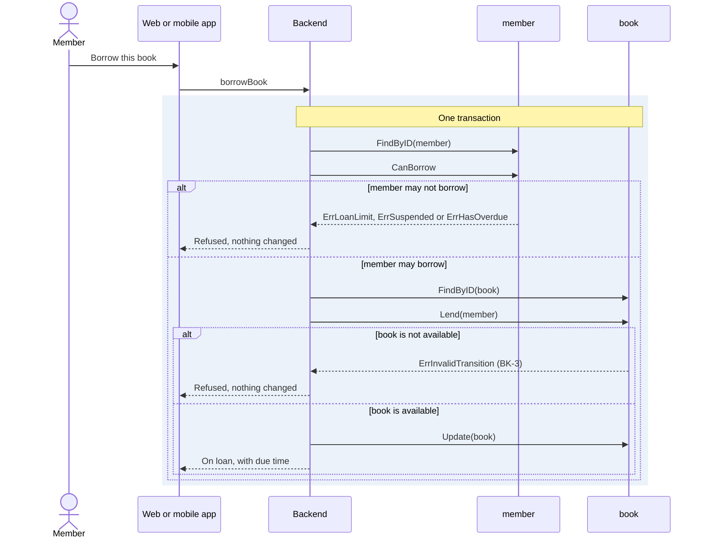

# Flow: Borrow a book

Reference flow. It shows how a flow is written.

- Serves: [Borrow a book](../goals/borrow-a-book.md).
- Crosses: [book](../artifacts/book/README.md) and
  [member](../artifacts/member/README.md).
- Contract: `borrowBook` in [borrow-book.openapi.yaml](borrow-book.openapi.yaml),
  and `getBook` in the [book contract](../artifacts/book/openapi.yaml).
- Trigger: a member asks to borrow a book on the web or the mobile app.
- Outcome: the book is on loan to the member, or nothing changes.

## Steps

1. The client asks for the book (`getBook`) and shows whether it is available.
2. The member confirms. The client asks the backend to lend the book to the
   signed-in member (`borrowBook`).
3. In one transaction, the backend:
   1. loads the member from `member` and checks that they may borrow, under
      MBR-2, MBR-3 and MBR-4;
   2. loads the book from `book`, under BK-8;
   3. lends the book to the member, under BK-3 and BK-4;
   4. stores the book.
4. The backend answers with the book, which now carries its due time.

## Scenarios

| ID | Given | When | Then | Covers |
| --- | --- | --- | --- | --- |
| F-BORROW-1 | An available book and an active member under the loan limit | The member calls `borrowBook` | The book is on loan to the member and the response carries its due time | G-BORROW-1, BK-3, BK-4, SYS-3 |
| F-BORROW-2 | A book on loan to another member | The member calls `borrowBook` | The loan is refused and the book stays with the other member | G-BORROW-2, G-BORROW-6, BK-3 |
| F-BORROW-3 | A member who holds as many books as the loan limit | The member calls `borrowBook` | The loan is refused and the book stays available | G-BORROW-3, G-BORROW-6, MBR-2 |
| F-BORROW-4 | A suspended member | The member calls `borrowBook` | The loan is refused | G-BORROW-6, MBR-3 |
| F-BORROW-5 | A member with an overdue loan | The member calls `borrowBook` | The loan is refused | G-BORROW-6, MBR-4 |
| F-BORROW-6 | A withdrawn book | The member calls `borrowBook` | The loan is refused | G-BORROW-6, BK-7 |
| F-BORROW-7 | A book on loan to another member | The member calls `getBook` | The response shows the book on loan and names no borrower | SYS-5, BK-9 |
| F-BORROW-8 | A member with an overdue loan | The member calls `getMyMember` | `can_borrow` is false, so the client can say why before the member tries | G-BORROW-6, MBR-4 |

## Not covered yet

- A member cannot reserve a book that is on loan. Reservations need an
  artifact of their own first.

Return to [flows](README.md).
