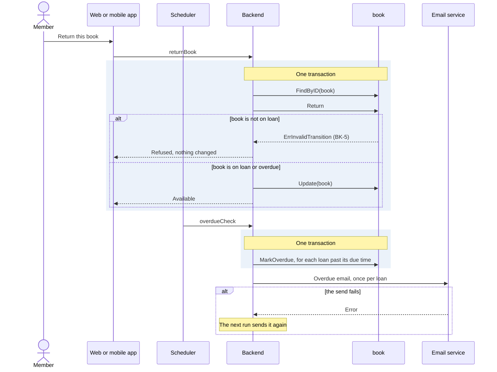

# Flow: Return a book

Reference flow with a worker. It shows a flow that a schedule starts.

- Serves: [Borrow a book](../goals/borrow-a-book.md).
- Crosses: [book](../artifacts/book/README.md) and
  [member](../artifacts/member/README.md).
- Contract: `returnBook`, the trigger `overdueCheck` and the overdue email
  payload, in [return-book.openapi.yaml](return-book.openapi.yaml).
- Trigger: a member returns a book on the web or the mobile app, or
  `overdueCheck`, which the scheduler fires every day at 02:00 in the
  library's time zone.
- Outcome: the book is available again, or a late loan is overdue and the
  member is told.

## Steps

### Return

1. The member returns the book. The client asks the backend to end the loan
   (`returnBook`).
2. In one transaction, the backend loads the book from `book` under BK-8, ends
   the loan under BK-5 and BK-10, and stores the book. The member's count of
   loans in `member` drops with it (MBR-2).
3. The backend answers with the book, now available.

### Overdue

1. The scheduler fires `overdueCheck`, and the overdue worker runs.
2. In one transaction, the worker finds every loan past its due time and marks
   the book overdue, under BK-6. From then on the member may not borrow
   (MBR-4).
3. After the transaction, the worker sends the overdue email to each member
   whose book it marked, once per loan. When a send fails, the book stays
   overdue, and the next run sends the email again.
4. When the same trigger arrives twice, the second run finds nothing new to
   mark and sends nothing (SYS-8).

## Scenarios

| ID | Given | When | Then | Covers |
| --- | --- | --- | --- | --- |
| F-RETURN-1 | A book on loan | The member calls `returnBook` | The book is available | G-BORROW-4, BK-5 |
| F-RETURN-2 | An available book | The member calls `returnBook` | The return is refused | BK-5 |
| F-RETURN-3 | A book on loan past its due time | `overdueCheck` fires | The book is overdue and the member gets the overdue email | G-BORROW-5, BK-6, SYS-5 |
| F-RETURN-4 | An overdue book | The member calls `returnBook`, then `borrowBook` on another book | The first book is available and the second loan goes through | G-BORROW-4, BK-5, MBR-4 |
| F-RETURN-5 | An overdue book | The member calls `getBook` | The status is overdue and the due time is the one that passed | G-BORROW-5, BK-6 |
| F-RETURN-6 | A book on loan to another member | The member calls `returnBook` | The return is refused and the loan goes on | G-BORROW-2, BK-10 |
| F-RETURN-7 | No loan past its due time | `overdueCheck` fires | Nothing changes and no email is sent | BK-6 |
| F-RETURN-8 | A book on loan past its due time, and an email service that fails | `overdueCheck` fires, then fires again the next day with the service back | The book is overdue after the first run; the member gets one overdue email, after the second run | G-BORROW-5, BK-6 |
| F-RETURN-9 | A book that the last run marked overdue and emailed about | `overdueCheck` fires again with the same `run_at` | Nothing changes and no second email is sent | BK-6, SYS-8 |

## Open questions

- Whether a member who returns a book late pays a fine, and how much
  (G-BORROW-5, F-RETURN-4).

Return to [flows](README.md).
