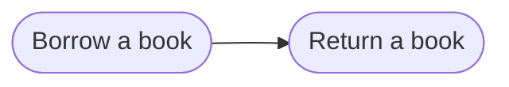

# Goal: Borrow a book

Reference goal. It shows how a goal is written.

## Need

A member borrows a book and brings it back, so that every member gets a fair
turn and the library knows where each book is.

- Actor: Member, on the web or the mobile app ([context](../system/context.md)).
- Follows: SYS-4, SYS-5 ([requirements](../system/requirements.md)).

## Success criteria

| ID | Criterion |
| --- | --- |
| G-BORROW-1 | A member in good standing borrows an available book and sees when it is due. |
| G-BORROW-2 | A book is on loan to one member at a time. |
| G-BORROW-3 | A member never holds more books than the loan limit. |
| G-BORROW-4 | A returned book can be borrowed again. |
| G-BORROW-5 | A loan not returned by its due time shows as overdue. |
| G-BORROW-6 | A loan that is refused changes nothing. |

## Flows

1. [Borrow a book](../flows/borrow-book.md)
2. [Return a book](../flows/return-book.md)

Return to [goals](README.md).
