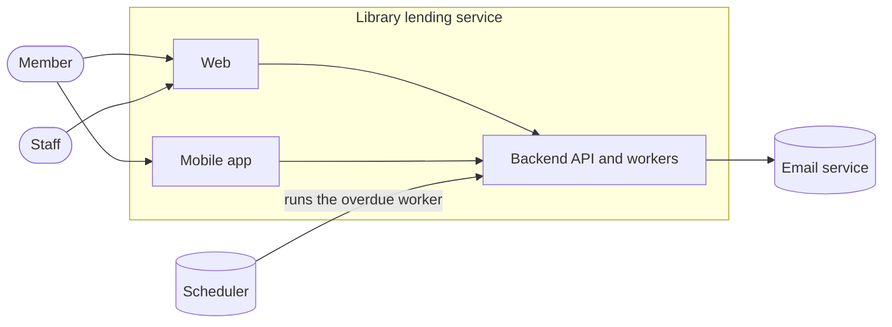

# Context

The library lending service lets members borrow books from a library and
return them, and lets staff look after the collection.

## Actors

| Actor | Uses |
| --- | --- |
| Member | Web, mobile app: find, borrow and return books |
| Staff | Web: add and withdraw books |

## Containers

| Container | Holds |
| --- | --- |
| Backend | The API and the workers |
| Web | The browser client for members and staff |
| Mobile app | The client for members |

## External systems

| System | Used for |
| --- | --- |
| Scheduler | Runs a backend worker at a set time |
| Email service | Sends messages to members |

Return to [system](README.md).
