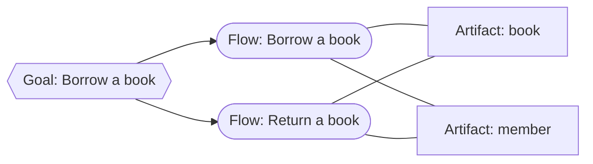

# Knowledge map

Goals use flows; flows cross artifacts. Artifacts are the nodes and flows the
edges between them.

| Goal | Flows | Artifacts |
| --- | --- | --- |
| [Borrow a book](../goals/borrow-a-book.md) | [Borrow a book](../flows/borrow-book.md), [Return a book](../flows/return-book.md) | [book](../artifacts/book/README.md), [member](../artifacts/member/README.md) |

Return to [system](README.md).
