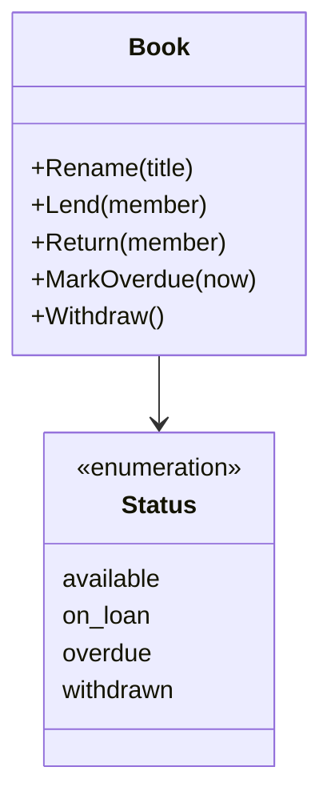
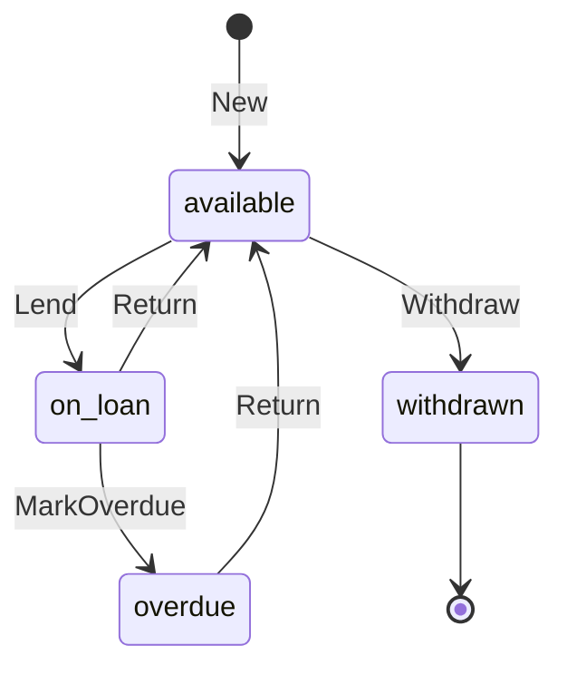

# Book specification

The behavior of a book in the collection and of its loan. It holds no
knowledge of any service, client or flow.

## Model

A book has a title and a status. While it is on loan or overdue, it also has
a borrower and a due time. They change only through the behaviors above.

## Rules

| ID | Rule | Error |
| --- | --- | --- |
| BK-1 | The title is not empty after trimming spaces. | `ErrInvalidTitle` |
| BK-2 | A new book starts as available. | — |
| BK-3 | Only an available book can be lent. | `ErrInvalidTransition` |
| BK-4 | Lending a book records the borrower and a due time `loan_days` after the loan. `loan_days` is a setting, default 14. A change to it applies to new loans only. | — |
| BK-5 | Only a book on loan or overdue can be returned. A return makes it available and clears the borrower and the due time. | `ErrInvalidTransition` |
| BK-6 | A book on loan whose due time has passed becomes overdue. Marking an overdue book again changes nothing. | — |
| BK-7 | A withdrawn book cannot be lent, renamed or returned. Only an available book can be withdrawn. | `ErrInvalidTransition` |
| BK-8 | Looking up a book that does not exist fails. | `ErrNotFound` |
| BK-9 | A book read by a member names its borrower only when the borrower is that member (SYS-5). | — |
| BK-10 | Only the borrower can return a book. | `ErrNotBorrower` |

## Lifecycle

Return to [Book](README.md).
