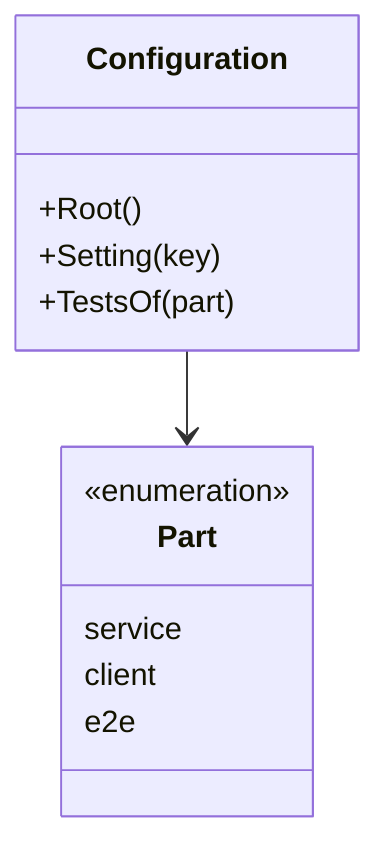

# Configuration specification

The root of a workspace and its settings. It holds no knowledge of any service
or flow.

## Model

The configuration is one JSON file at the root. Its keys and their defaults
are in the [contract](openapi.yaml). The team changes it by hand; no script
writes it.

## Rules

| ID | Rule | Error |
| --- | --- | --- |
| CFG-1 | The root is the nearest folder, from the current folder up, that holds `artifact-driven.json`. When no folder holds one, the root is the folder that holds the scripts. | — |
| CFG-2 | Every key is optional. A key that is not given takes its default. | — |
| CFG-3 | A key that is given replaces its default as a whole: a `skip` list names every folder to skip, the default ones included. Only the keys of `site` take their defaults one by one. | — |
| CFG-4 | The tests of a part are the files under its tests `folder`, relative to the root, that match its `glob`, `**/*_test.*` by default. A part with no tests `folder` has no tests. The parts are each service, each client given as an object, and `e2e`. | — |
| CFG-5 | The tests of a part are read only while its tests folder exists. | — |
| CFG-6 | The tests setting of a part may name the `repository` of the part's clone, as `owner/repo` or `owner/repo@ref`. Its tests `folder` is then where the clone sits in the workspace, and its `glob` applies inside that repository. The scripts do not read `repository`. | — |
| CFG-7 | A configuration that is not valid JSON, or that is not a JSON object, stops every script before it reads anything else, with one line on standard error that names the file, the line and the column, and status 2 (SYS-3). | `ErrInvalidConfiguration` |
| CFG-8 | A folder given in place of the tests of every part is read, for each part whose tests folder is that folder or under it, with that part's glob. A folder that holds no part's tests folder is read with the default glob. | — |

Return to [Configuration](README.md).
