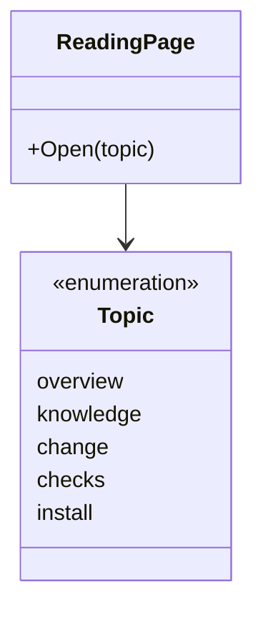

# Introduction specification

The behavior of the introduction: its sample, explanations and links.
It holds no knowledge of any service or flow.

## Model

The reader follows one path through What it is, Knowledge, A change, Checks
and Start, or opens a topic directly. The sample makes the relationships
concrete. Detailed references can be opened without leaving the reading path.

## Rules

| ID | Rule | Error |
| --- | --- | --- |
| INTRO-1 | Withdrawn. The seven-step story is replaced by a reader-controlled path. | — |
| INTRO-2 | Every goal, flow, knowledge ID, artifact and client in the explanation exists in the sample and has the relationships the sample defines. An illustrative scan result is labeled as an example. A claimed script result or count is reproducible from the named sample; the page does not invent results. | — |
| INTRO-3 | The page explains that the scan finds knowledge IDs in test files without running the tests. A named ID is a traceability link, not proof that the behavior works or that a test passed (TST-3). | — |
| INTRO-4 | The worked change starts from one rule and shows how to find the flows, contracts and client needs it affects. Claims about affected or unaffected clients follow the impact output. The page states no cost or duration of a change, and no plan or status. | — |
| INTRO-5 | Withdrawn. The reading path does not autoplay. | — |
| INTRO-6 | Withdrawn: moved to MTH-3. | — |
| INTRO-7 | Withdrawn: moved to SYS-8. | — |
| INTRO-8 | Without access to another host, the page still shows its explanations and sample in the fonts of the system. | — |
| INTRO-9 | Withdrawn. Explanations are readable without pointing at an animated block. | — |
| INTRO-10 | The page explains each knowledge layer in plain words with a sample example. System is shared by all layers. A goal cites flows; a flow cites artifacts. Rules belong to an artifact, not a separate layer. Contracts, client needs and tests appear as related dependencies, not additional layers in that citation chain. | — |
| INTRO-11 | Withdrawn: moved to MTH-1. | — |
| INTRO-12 | Withdrawn: moved to MTH-2. | — |
| INTRO-13 | Withdrawn: moved to SYS-8. | — |
| INTRO-14 | Withdrawn: moved to INTRO-19. | — |
| INTRO-15 | Withdrawn: moved to SYS-8. | — |
| INTRO-16 | Withdrawn. Each step names the known practice it uses (MTH-10); a separate list of practices added nothing. | — |
| INTRO-17 | Withdrawn: moved to SYS-8. | — |
| INTRO-19 | The page connects the team tasks it describes to the framework resources that handle them. Examples use the sample and state no cost, duration or speed. | — |

Return to [Introduction](README.md).
