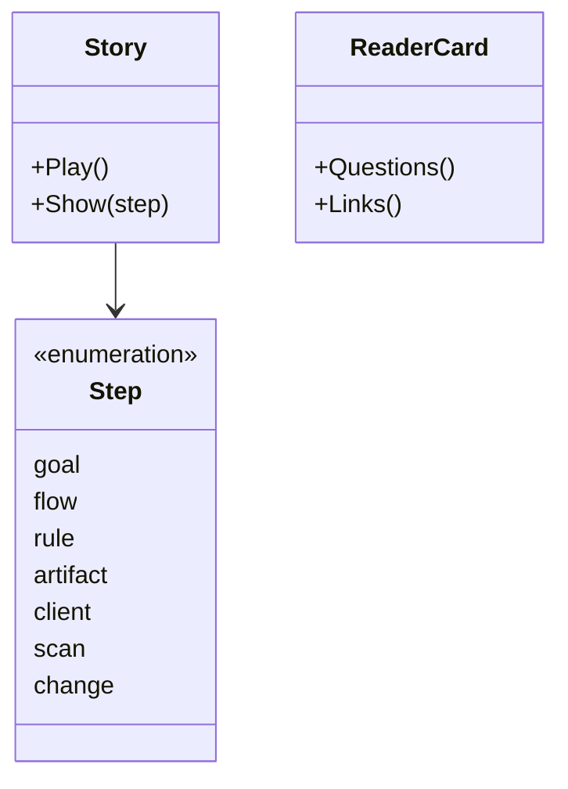
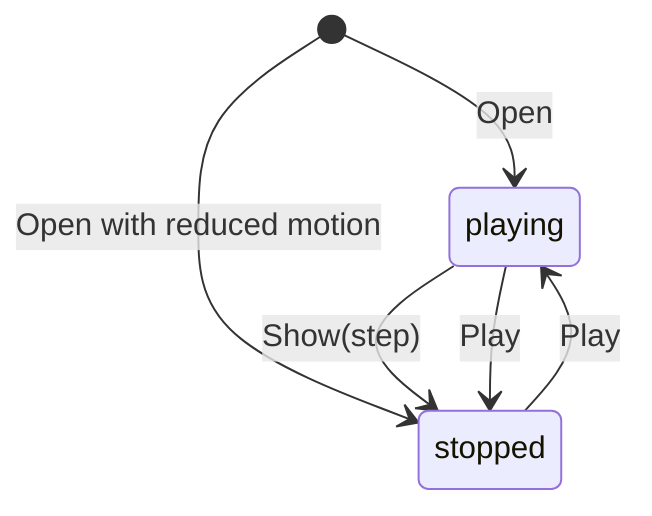

# Introduction specification

The behavior of the landing page: its story, its reader cards and its links.
It holds no knowledge of any service or flow.

## Model

The page has one story, then the situations a team meets and what answers
each.

## Rules

| ID | Rule | Error |
| --- | --- | --- |
| INTRO-1 | The story has seven steps in this order: goal, flow, rule, artifact, client, scan, change. Each step shows what the step before it showed and adds one layer, with one sentence that says what the new layer is. | — |
| INTRO-2 | Every goal, flow, knowledge ID, artifact and client that the story shows is one the sample holds, linked as the sample links it. Which rules the story shows as found by the scan is an example, and the scan step says so. | — |
| INTRO-3 | The scan step shows which rules a test names, as rules found in the product. The page says how the scan finds a rule - by its ID in a test file, without running the test - and that a rule found is not proof that the code is right (TST-3). | — |
| INTRO-4 | The change step starts from one rule and shows every flow and client that a change to it affects, and the clients it does not affect. The page states no cost or duration of a change, and no plan or status. | — |
| INTRO-5 | The story plays by itself, one step after the other, and goes back to the first step after the last. It stops when the reader picks a step. When the reader's system asks for reduced motion, the story does not play and shows the last step. | — |
| INTRO-6 | Withdrawn: moved to MTH-3. | — |
| INTRO-7 | The page has a light theme only, also when the reader's system uses a dark theme. At a width of 360 px it needs no horizontal scrolling. | — |
| INTRO-8 | The page needs no build step and loads no script from another host. Without access to another host, it still shows the story, in the fonts of the system. | — |
| INTRO-9 | Each block of the story, when the reader points at it or taps it, explains in plain words what it is in the sample. While the reader points at a block, the story does not move on. | — |
| INTRO-10 | Above the story, the page names the layers in order - goal, flow, rule, artifact, client - each with one plain sentence and an example from the sample. | — |
| INTRO-11 | Withdrawn: moved to MTH-1. | — |
| INTRO-12 | Withdrawn: moved to MTH-2. | — |
| INTRO-13 | The page links the framework page at its top and at its foot. | — |
| INTRO-14 | After the story, the page lists situations of a team's day - a rule changes, a defect is reported, someone joins, a release is near, a stakeholder asks how it goes, the docs drift from the code - each with the question it raises, what in the framework answers it, and an example from the sample. It states no cost, duration or speed. | — |
| INTRO-15 | The page links the how-we-work page at its top and after the situations, and the project tracker at its top and at its foot. | — |
| INTRO-16 | Among the notes, the page says that the framework invents no method, names the known practices it puts together, and links the list on the how-we-work page. | — |
| INTRO-17 | The page links the agents page beside each link to the how-we-work page: at its top, after the situations and at its foot. | — |

## Lifecycle

Return to [Introduction](README.md).
