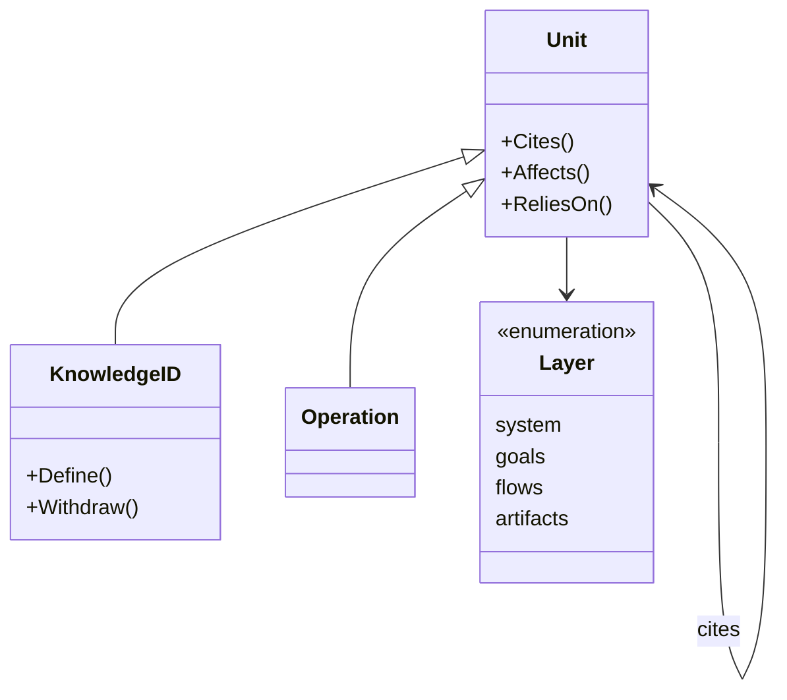

# Knowledge specification

The knowledge IDs, the operations and the citations between units, as the
scripts read them from the knowledge folder. It holds no knowledge of any
service or flow.

## Model

A unit belongs to the layer of the folder it is in. The scripts read pages
and contracts as text (SYS-6). Units and their citations form a graph; a
change follows the citations up, and what a unit relies on follows them down.

## Rules

| ID | Rule | Error |
| --- | --- | --- |
| KN-1 | A knowledge ID is a prefix of one to six capital letters, an optional hyphen and second part of up to eight capital letters, then a hyphen and a number. A name that starts with `UTF`, `ISO`, `RFC`, `SHA`, `TLS`, `HTTP` or `IEEE` and a hyphen is not a knowledge ID. | — |
| KN-2 | A knowledge ID is defined by a table row of a page or contract in the knowledge folder whose first cell is that ID. Each ID is defined once. | `ErrDefinedTwice` |
| KN-3 | A row whose text starts with `Withdrawn` withdraws its ID. No line names a withdrawn ID except the row that withdraws it. | `ErrWithdrawnCited` |
| KN-4 | Every knowledge ID that a page or a contract in the knowledge folder names is defined. | `ErrNotDefined` |
| KN-5 | A page or contract of a flow names no goal criterion. A page or contract of an artifact names no goal criterion and no flow scenario. | `ErrCitesUp` |
| KN-6 | An operation is an `operationId`, or a name under the root key `x-triggers` or `x-commands`, of a contract in the knowledge folder. Each flow scenario that is not withdrawn names at least one operation in backticks, and each operation is named by at least one scenario. | `ErrNoOperation` |
| KN-7 | A unit cites each knowledge ID in its text and each schema it names by `$ref`. A unit of a page also cites each operation it names in backticks, and a section of a client page cites the operation, schema or knowledge ID its heading names. A page cites each page of a lower layer that it links to. | — |
| KN-8 | A change to a unit affects every unit that cites it, directly or through other units, and every page that links down to the page of an affected unit, directly or through other pages. | — |
| KN-9 | A unit relies on every unit it cites, directly or through other units, and on every page of a lower layer that the pages of those units link to. | — |
| KN-10 | A name stands for the unit with that name. When no unit has it, it stands for every knowledge ID with that prefix, such as each criterion of a goal; else for every unit of the page at that path in the knowledge folder; else for every unit with a schema property of that name or that names it in backticks. A name that stands for nothing is an error. | `ErrNothingCites` |
| KN-11 | The size of a goal counts what its criteria rely on: criteria, flows, scenarios, rules, operations, artifacts and client pages. The blast radius of a requirement, a rule or an operation counts what a change to it affects: flows, scenarios, operations, artifacts and client pages. | — |
| KN-12 | An open question holds a goal when it names a knowledge ID or an operation that the goal relies on, or a criterion of the goal. | — |

## Open questions

- A name of a standard with a number, other than those KN-1 lists, has the
  form of a knowledge ID. Written in the knowledge folder, it fails KN-4
  (KN-1, KN-4). Whether the list of such names must be part of the
  configuration.

Return to [Knowledge](README.md).
