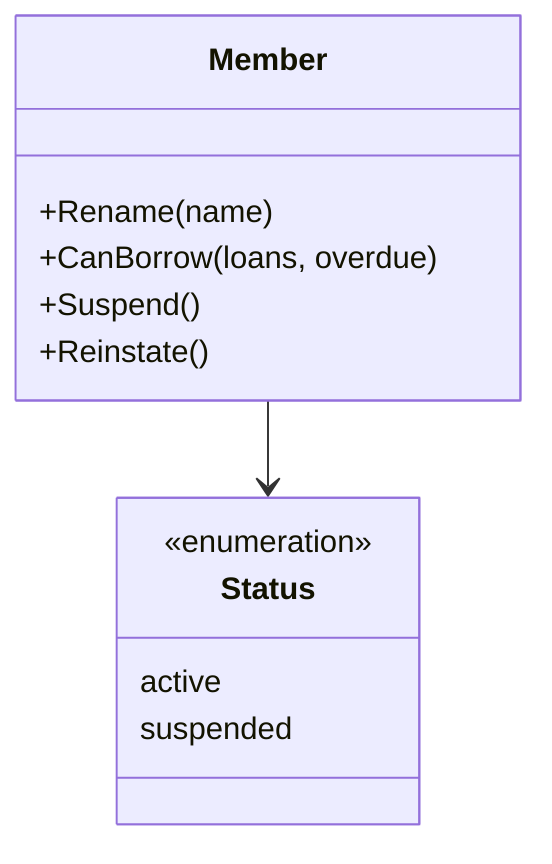
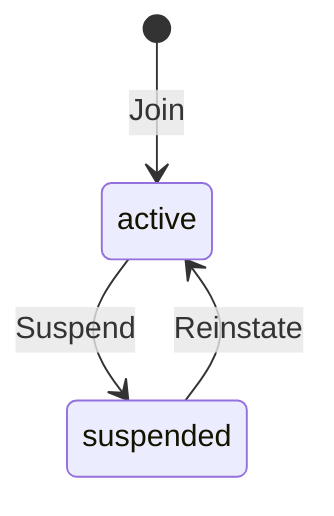

# Member specification

The behavior of a member. It holds no knowledge of any service, client or flow.

## Model

A member has a name and a status. They change only through the behaviors
above. A member's loans are the books on loan to them.

## Rules

| ID | Rule | Error |
| --- | --- | --- |
| MBR-1 | The name is not empty after trimming spaces. | `ErrInvalidName` |
| MBR-2 | A member holds at most the loan limit of their home region in books on loan or overdue at once, as [Values](#values) lists (SYS-7). A change to the limit applies to new loans only. | `ErrLoanLimit` |
| MBR-3 | A suspended member cannot borrow. | `ErrSuspended` |
| MBR-4 | A member with an overdue book cannot borrow until they return it. | `ErrHasOverdue` |
| MBR-5 | Looking up a member that does not exist fails. | `ErrNotFound` |
| MBR-6 | Withdrawn. MBR-2 holds the loan limit for every region. | — |

## Values

The loan limit of MBR-2, by region:

| Region | Loan limit |
| --- | --- |
| North | 3 |
| South | 5 |

## Lifecycle

Return to [Member](README.md).
