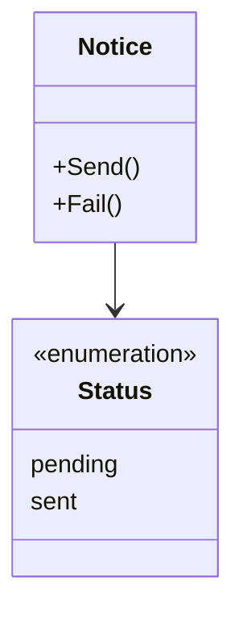
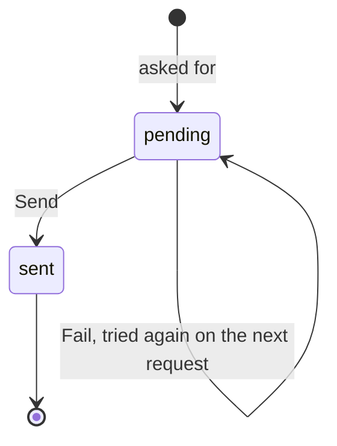

# Notice specification

The behavior of a notice. It holds no knowledge of any service, client or flow.

## Model

A notice has a key, the member it goes to, a template and the fields of the
template. The service that asks for it chooses the key.

## Rules

| ID | Rule | Error |
| --- | --- | --- |
| NTC-1 | A notice is sent at most once per key. A request with the key of a sent notice changes nothing and answers with that notice. A request with the key of a pending notice tries to send it again. | — |
| NTC-2 | A notice goes to one member and carries only the fields of its template. | `ErrInvalidNotice` |

Return to [Notice](README.md).
