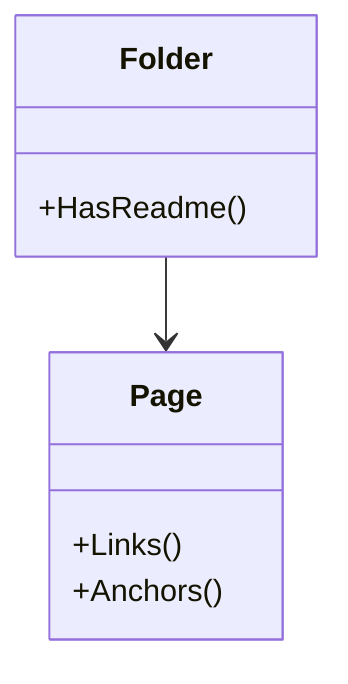

# Repository specification

The folders and the Markdown pages of a workspace, and their links. It holds
no knowledge of any service or flow.

## Model

A folder counts when Git tracks a file in it, or would track a file in it
that it does not ignore. A page is a Markdown file that is not under a folder whose
name the configuration skips. A link is relative, or it starts with
`http://`, `https://` or `mailto:`.

## Rules

| ID | Rule | Error |
| --- | --- | --- |
| REPO-1 | Every folder that counts has a `README.md`: the root, and each folder between the root and a file that Git tracks or would track. Folders that Git ignores, and the folder of Git itself, do not count. | `ErrNoReadme` |
| REPO-2 | A relative link in a page points to a file or a folder that exists. A link that starts with `http://`, `https://` or `mailto:` is not checked. | `ErrBrokenLink` |
| REPO-3 | A link to a heading names a heading of the page it points to, or of its own page when it has no path. The anchor of a heading is its text in lowercase, with every character other than a letter, a digit, a space or a hyphen removed, and each space made a hyphen. When headings of one page have the same anchor, the second takes it with `-1` added, the third with `-2`, and so on, as GitHub gives them. | `ErrMissingAnchor` |

Return to [Repository](README.md).
