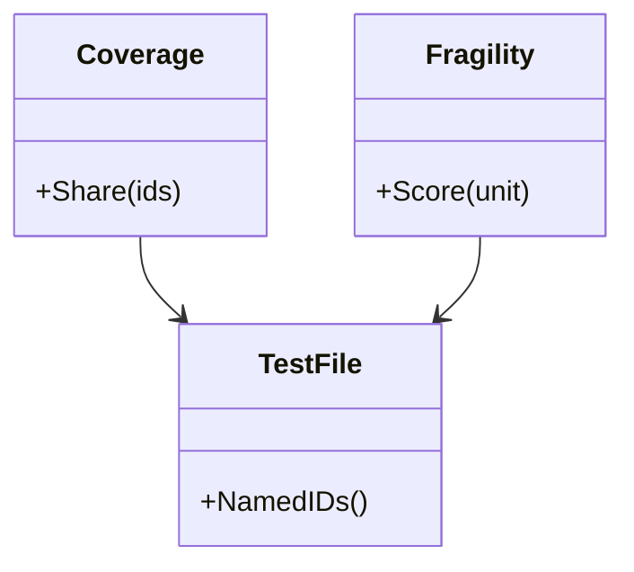

# Test specification

Which knowledge IDs the test files of a part name, and how strongly each one
is proved. It holds no knowledge of any service or flow.

## Model

A test file is read as text and never run (SYS-6).

## Rules

| ID | Rule | Error |
| --- | --- | --- |
| TST-1 | A test file names a knowledge ID when the ID is anywhere in its text, such as in a docstring or a comment. A file names each ID once, however often it holds it. | — |
| TST-2 | A test file names only knowledge IDs that the knowledge defines and has not withdrawn. An ID whose prefix no defined ID has is not a knowledge ID of the workspace, and this rule does not apply to it. | `ErrUnknownID` |
| TST-3 | A knowledge ID is tested when at least one test file names it. Tested says nothing about whether a test passes or proves the rule. | — |
| TST-4 | The coverage of a set of knowledge IDs gives, for criteria, scenarios and rules, how many are tested out of how many, and the tested share of all of them as a whole percent. Withdrawn IDs and system requirements are not counted. | — |
| TST-5 | The fragility of a requirement, a rule, an operation or a schema is its reach times one plus its weakness, plus 8 when an open question names it. Reach counts the scenarios and criteria a change to it affects, its operations twice and its client pages three times. Weakness adds 1 for a knowledge ID that no scenario cites, and 1 for a knowledge ID that no test file names when test files are read. | — |

## Open questions

- Coverage leaves out system requirements, while tests name them as they
  name rules (TST-4). Whether coverage must count them.

Return to [Test](README.md).
