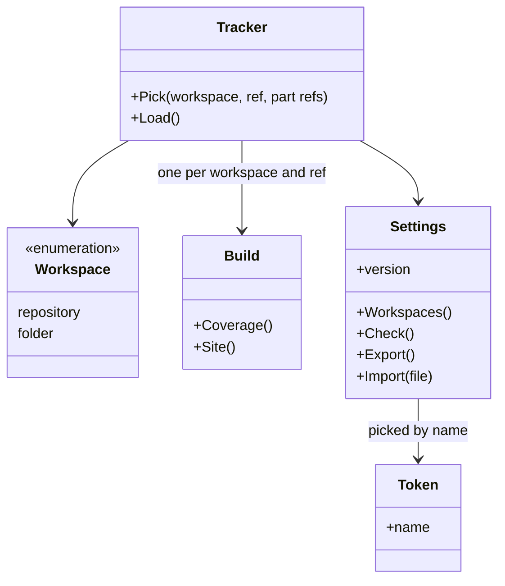
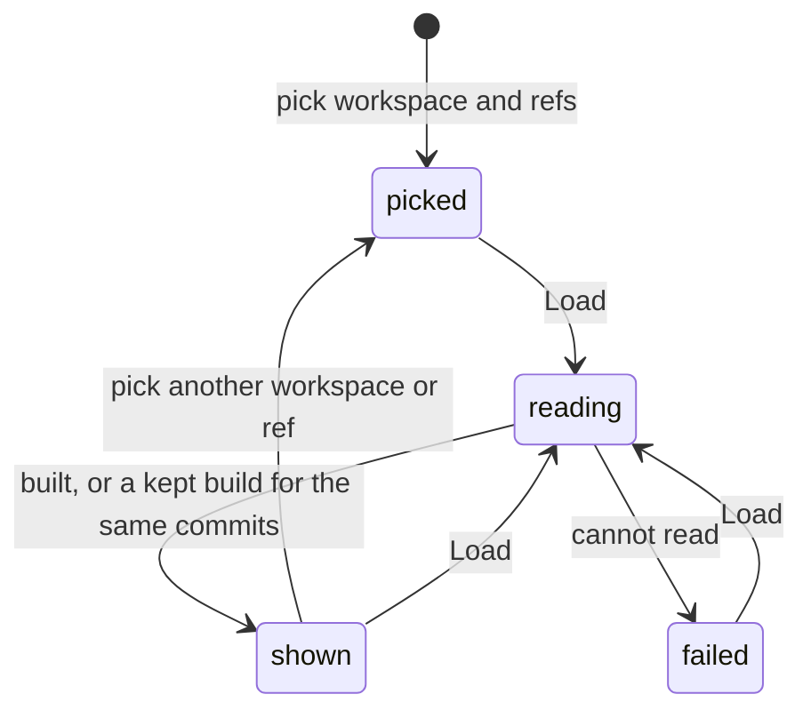

# Tracker specification

The behavior of the project tracker: the workspace and the ref it shows, what
it reads, what it shows first, and what the browser keeps. It builds the
knowledge site and the coverage with the code of the `scripts` service, and
holds none of their rules.

## Model

A workspace is a GitHub repository, read at a branch, a tag or a commit, or a
folder on the computer of the reader, read as it is on disk. A build is what
the tracker shows for one workspace at one ref. A token is kept by the name
the reader gives it, and a workspace or a part names the token it uses.

## Rules

| ID | Rule | Error |
| --- | --- | --- |
| TRK-1 | The tracker shows one workspace at one ref at a time. The reader picks the workspace, its ref and the ref of each part whose tests setting names a repository, then asks to load; picking alone reads and builds nothing. The address may name the workspace and the ref, and the tracker then loads those when the page opens. With none named and none chosen before, it loads the repository of the framework at its default branch. | — |
| TRK-2 | For a build, the tracker reads the configuration, the knowledge folder and the test files of each part of the workspace at the ref, and runs the scripts of the framework on them in the browser. It changes no file of the workspace and runs no test (SYS-4, SYS-6). | — |
| TRK-3 | A build shows first, for each goal, the coverage that `measureCoverage` prints for the same files, with one sentence that says a rule counts when a test names its ID, not when the test passes (TST-3, TST-4). Above the coverage, the page names each part whose test files it could not read and why, since coverage then leaves them out. The knowledge site follows. | — |
| TRK-4 | In a repository, the test files of a part come from the repository its tests setting names (CFG-6), at the ref the reader chose for that part, or else at the ref in the setting, or else at its default branch. A part whose setting names no repository keeps them in the tests folder of the workspace's repository, at the ref shown (CFG-4). In a folder, they come from the tests folder of the part (CFG-4). A part with no test files to read is listed by name. | — |
| TRK-5 | The tracker keeps each file it read from GitHub by its Git blob SHA, and each build by the commits and the configuration it was made from. Each load reads the commit and the file tree of each ref through the API, downloads only the files whose blob SHA it does not keep, and builds again only when a commit or the configuration differs from a kept build. A file of a repository read with no token is downloaded from `raw.githubusercontent.com` by commit and path, so it does not count against GitHub's API limit; a file of a repository read with a token comes through the API. | — |
| TRK-6 | A token is a read-only GitHub token with a name the reader gives it. The reader picks one token, or none, for each workspace in a repository and for each part whose tests setting names a repository. The tracker sends a token only to `api.github.com`, only for the repository it was picked for. It keeps the values only until the tab closes; the settings it stores or exports hold the name of each token picked, never its value. | — |
| TRK-7 | The settings - the workspaces; the ref and the token name picked for each workspace and each part; and the configuration changed for a workspace (TRK-12) - are kept in the browser with a version. Settings of an older version are migrated when the page loads them or imports them. Settings of a newer version are shown, with a warning, and not stored. | — |
| TRK-8 | In a folder, the tracker skips `.git`, `node_modules` and the folders the configuration skips, and shows the branch that `.git/HEAD` names. Where the browser cannot keep access to the folder, the page says that the folder must be chosen again after each page load. | — |
| TRK-9 | A repository, a ref, a part or a folder that cannot be read is reported with the reason. The other parts and workspaces still build. | — |
| TRK-10 | The page has a light theme only, in the fonts and colors of the landing page, also when the reader's system uses a dark theme. At a width of 360 px it needs no horizontal scrolling. It needs no build step, and loads scripts only from its own host and Pyodide from jsDelivr. | — |
| TRK-11 | The settings show, for each workspace, each part whose tests setting names a repository, and each token, only whether the tracker can connect to it and, when it cannot, why: not found, no access with the token picked, no token picked for a private repository, a token GitHub refuses, or a folder to choose again. What a part's tests hold is shown by the build, not here. The tracker checks each one once per page load, the first time the settings show it; again only when the reader adds it, picks another token for it, or asks to check again; with one call to GitHub for each repository and each token, and one to read the configuration of each workspace. The parts are read from the configuration of the workspace; the tracker does not change them. | — |
| TRK-12 | The reader may change the configuration of a workspace in the tracker, to try it. The changed configuration is kept in the settings for that workspace and is never written to the workspace. Before it is used, the tracker reports JSON that does not parse and any key or value the configuration contract does not allow, and does not build with it. Each build made with it says so above the coverage, and the reader can go back to the configuration of the workspace. | — |
| TRK-13 | For each workspace in a repository, the settings give a shell script that clones it at the ref picked, and the repository of each part whose tests setting names one at the ref picked for that part, into the part's tests folder (CFG-6). The reader runs it in any folder, with their own git access, then adds the clone as a folder. The script holds no token. | — |

## Lifecycle

## Open questions

- Which pages of the knowledge site a stakeholder needs and which only a
  solution architect needs, and whether the tracker hides the second ones
  until asked (TRK-3).

Return to [Tracker](README.md).
