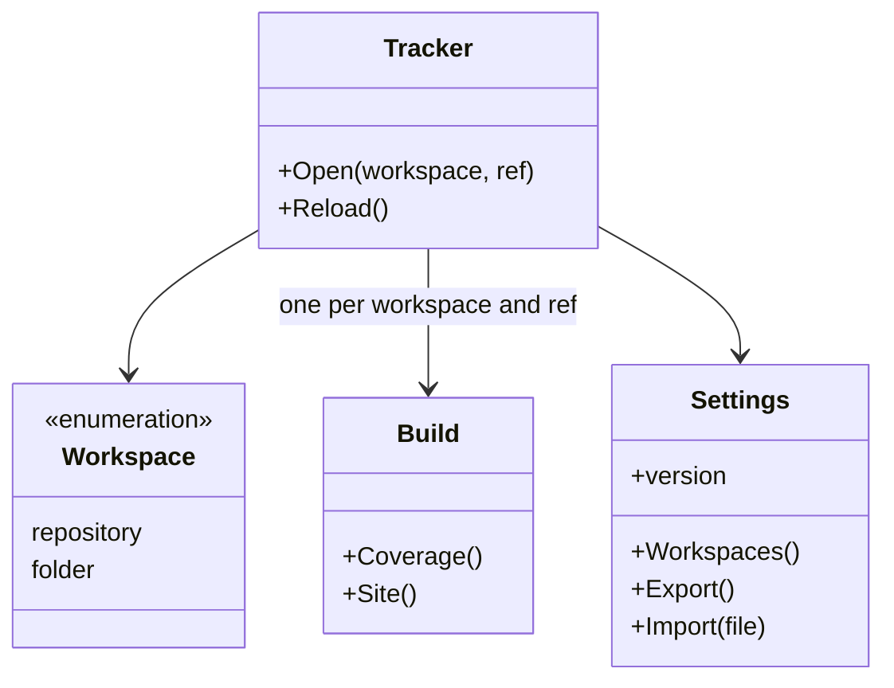
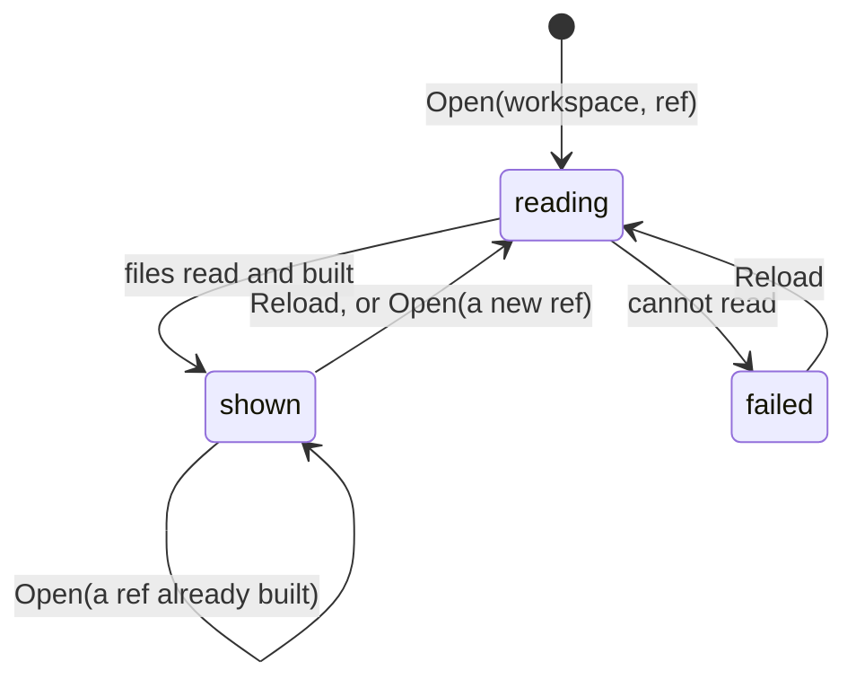

# Tracker specification

The behavior of the project tracker: the workspace and the ref it shows, what
it reads, what it shows first, and what the browser keeps. It builds the
knowledge site and the coverage with the code of the `scripts` service, and
holds none of their rules.

## Model

A workspace is a GitHub repository, read at a branch, a tag or a commit, or a
folder on the computer of the reader, read as it is on disk. A build is what
the tracker shows for one workspace at one ref.

## Rules

| ID | Rule | Error |
| --- | --- | --- |
| TRK-1 | The tracker shows one workspace at one ref at a time. The address may name the workspace and the ref, and the tracker opens those. With none named and none chosen before, it opens the repository of the framework at its default branch. | — |
| TRK-2 | For a build, the tracker reads the configuration, the knowledge folder and the test files of each part of the workspace at the ref, and runs the scripts of the framework on them in the browser. It changes no file of the workspace and runs no test (SYS-4, SYS-6). | — |
| TRK-3 | A build shows first, for each goal, the coverage that `measureCoverage` prints for the same files, with one sentence that says a rule counts when a test names its ID, not when the test passes (TST-3, TST-4). The knowledge site follows. | — |
| TRK-4 | In a repository, the test files of a part come from the repository its tests setting names (CFG-6), at the ref the reader chose for that part, or else at the ref in the setting, or else at its default branch. A part whose setting names no repository keeps them in the tests folder of the workspace's repository, at the ref shown (CFG-4). In a folder, they come from the tests folder of the part (CFG-4). A part with no test files to read is listed by name. | — |
| TRK-5 | The tracker keeps each file it read from GitHub by its Git blob SHA, and each build until the reader reloads it. A reload reads the commit and the file tree of the ref, and downloads only the files whose blob SHA changed. | — |
| TRK-6 | A token is read-only and set for one owner, or for `*`, any owner without a token of its own. The tracker keeps it only until the tab closes, sends it only to `api.github.com`, and never puts it in the settings it stores or exports. | — |
| TRK-7 | The settings - the workspaces and the ref chosen for each workspace and each part - are kept in the browser with a version. Settings of an older version are migrated when the page loads them or imports them. Settings of a newer version are shown, with a warning, and not stored. | — |
| TRK-8 | In a folder, the tracker skips `.git`, `node_modules` and the folders the configuration skips, and shows the branch that `.git/HEAD` names. Where the browser cannot keep access to the folder, the page says that the folder must be chosen again after each page load. | — |
| TRK-9 | A repository, a ref, a part or a folder that cannot be read is reported with the reason. The other parts and workspaces still build. | — |
| TRK-10 | The page has a light theme only, in the fonts and colors of the landing page, also when the reader's system uses a dark theme. At a width of 360 px it needs no horizontal scrolling. It needs no build step, and loads scripts only from its own host and Pyodide from jsDelivr. | — |

## Lifecycle

## Open questions

- Which pages of the knowledge site a stakeholder needs and which only a
  solution architect needs, and whether the tracker hides the second ones
  until asked (TRK-3).

Return to [Tracker](README.md).
