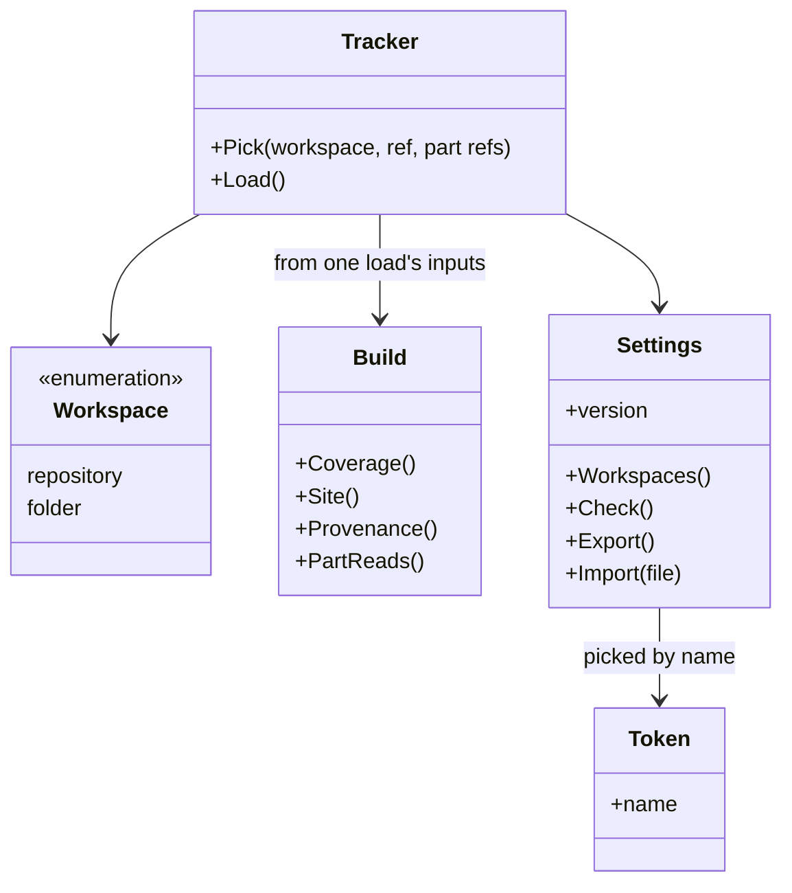
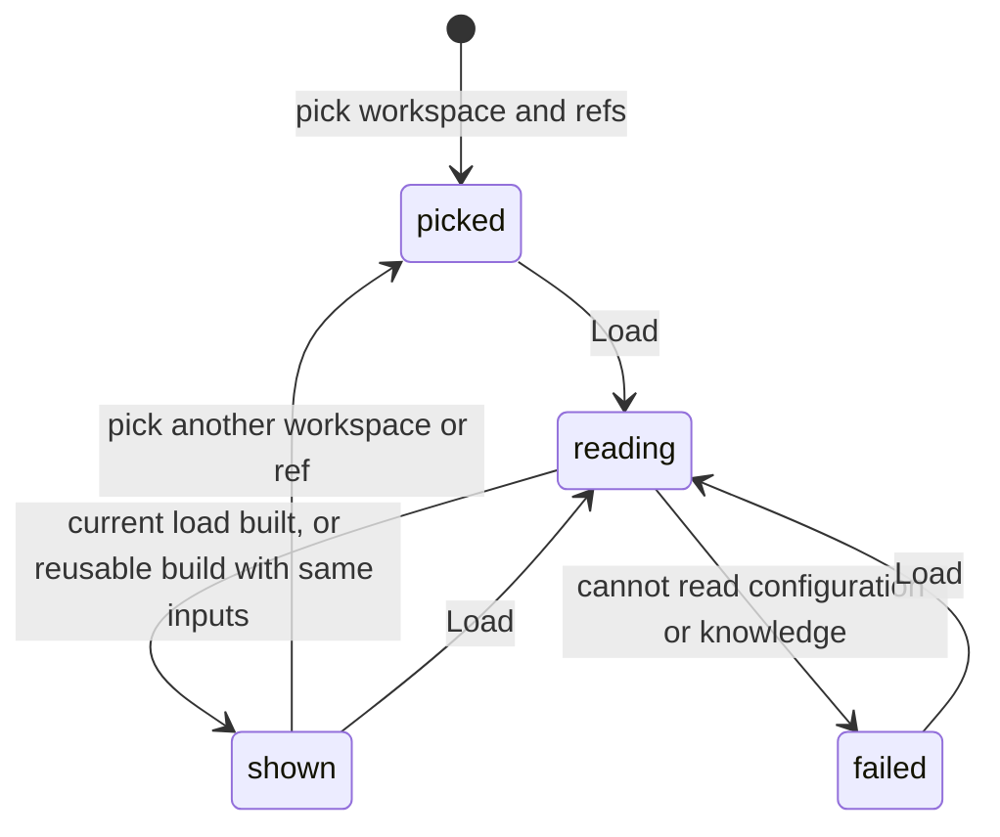

# Tracker specification

The behavior of the project tracker: the workspace and the ref it shows, what
it reads, what it shows first, and what the browser keeps. It builds the
knowledge site and the coverage with the code of the `scripts` service, and
holds none of their rules.

## Model

A workspace is a GitHub repository, read at a branch, a tag or a commit, or a
folder on the computer of the reader, read as it is on disk. A build holds the
result of one load, its source identities and the read outcome of each part.
A token is kept by the name the reader gives it, and a workspace or a part
names the token it uses.

## Rules

| ID | Rule | Error |
| --- | --- | --- |
| TRK-1 | The tracker shows one workspace at one ref at a time. The reader picks the workspace, its ref and the ref of each part whose tests setting names a repository, then asks to load; picking alone reads and builds nothing. The address may name the workspace and the ref, and the tracker then loads those when the page opens. With none named and none chosen before, it loads the repository of the framework at its default branch. | — |
| TRK-2 | For a build, the tracker reads the configuration, the knowledge folder and the test files of each part from the load's inputs (TRK-15), and runs the scripts of the framework on the files in the browser. The effective configuration determines the parts to read (CFG-4, CFG-6). It changes no file of the workspace and runs no test (SYS-4, SYS-6). | — |
| TRK-3 | A build shows first, for each goal, the coverage that `measureCoverage` prints for the same included files, with one sentence that says a rule counts when a test names its ID, not when the test passes (TST-3, TST-4). Above the coverage, it identifies the load's sources (TRK-17) and each failed or missing part with its reason (TRK-16). It does not present coverage from an incomplete read as coverage of all parts. The knowledge site follows. | — |
| TRK-4 | In a repository, the test files of a part come from the repository its tests setting names (CFG-6), at the ref the reader chose for that part, or else at the ref in the setting, or else at its default branch. A part whose setting names no repository keeps them in the tests folder of the workspace's repository, at the ref shown (CFG-4). In a folder, they come from the tests folder of the part (CFG-4). A part with no test files to read is listed by name. | — |
| TRK-5 | The tracker keeps each successfully read GitHub file by its full Git blob SHA. Each load resolves the commit and file tree of every selected repository ref through the API, and downloads only files it does not keep. A kept build is reusable only when the repository identities and full resolved commits, effective configuration and analyzer identity (TRK-17) match, and no required source read failed or remains unresolved. A confirmed missing tests setting, folder or set of matching files does not prevent reuse; its outcome remains missing (TRK-16). Short commit labels never identify a kept build. Failed reads are not kept as successful data or reusable builds; a later load retries them, even at the same commits. Requested refs, configuration source, read outcomes and warnings belong to the current load, even when its analysis is reused. A file of a repository read with no token is downloaded from `raw.githubusercontent.com` by commit and path, so it does not count against GitHub's API limit; a file of a repository read with a token comes through the API. | — |
| TRK-6 | A token is a read-only GitHub token with a name the reader gives it. The reader picks one token, or none, for each workspace in a repository and for each part whose tests setting names a repository. The tracker sends a token only to `api.github.com`, only for the repository it was picked for. It keeps the values only until the tab closes; the settings it stores or exports hold the name of each token picked, never its value. | — |
| TRK-7 | The settings - the workspaces; the ref and the token name picked for each workspace and each part; and the configuration changed for a workspace (TRK-12) - are kept in the browser with a version. Settings of an older version are migrated when the page loads them or imports them. Settings of a newer version are shown, with a warning, and not stored. | — |
| TRK-8 | In a folder, the tracker skips `.git`, `node_modules` and the folders the configuration skips, except that it may read `.git/HEAD` for a branch or detached-commit label. The result says it used working-copy files, not an atomic disk snapshot or the contents of that Git commit (TRK-17). Each load reads the folder again. Where the browser cannot keep access to the folder, the page says that the folder must be chosen again after each page load. | — |
| TRK-9 | A repository, a ref, a part, a file or a folder that cannot be read is reported with the reason. A failed test-file read excludes that part under TRK-16 and does not stop other parts. When the workspace configuration or knowledge cannot be read completely, no new build is shown; an older build, if retained, keeps its own identity and is not labeled as the failed load. Other workspaces remain usable. | — |
| TRK-10 | The page has a light theme only, in the fonts and colors of the landing page, also when the reader's system uses a dark theme. At a width of 360 px it needs no horizontal scrolling. It needs no build step. Scripts load only from its own host and, for Pyodide and the knowledge site's Mermaid library and layout support, jsDelivr. Workspace content cannot choose additional script sources (SYS-7). | — |
| TRK-11 | The settings show, for each workspace, each part whose tests setting names a repository, and each token, only whether the tracker can connect to it and, when it cannot, why: not found, no access with the token picked, no token picked for a private repository, a token GitHub refuses, or a folder to choose again. What a part's tests hold is shown by the build, not here. The tracker checks each one once per page load, the first time the settings show it; again only when the reader adds it, picks another token for it, or asks to check again; with one call to GitHub for each repository and each token, and one to read the configuration of each workspace. The parts are read from the configuration of the workspace; the tracker does not change them. | — |
| TRK-12 | The reader may change the configuration of a workspace in the tracker, to try it. The changed configuration is kept in the settings for that workspace and is never written to the workspace. Before it is used, the tracker reports JSON that does not parse and any key or value the configuration contract does not allow, and does not build with it. Each build made with it says so above the coverage. Changing or restoring the configuration applies to the next load and does not change the configuration identity or override label of a build already read (TRK-15). | — |
| TRK-13 | For each workspace in a repository, the settings give a shell script that clones it at the ref picked, and the repository of each part whose tests setting names one at the ref picked for that part, into the part's tests folder (CFG-6). The reader runs it in any folder, with their own git access, then adds the clone as a folder. The script holds no token. | — |
| TRK-14 | The embedded knowledge site is sandboxed with an origin separate from the tracker. It cannot read or change the tracker's document, settings, browser storage or token values, or navigate the parent. Rendering follows SYS-7. Site controls, goal details, diagram navigation and readable source fallback still work within that boundary. The frame fits its content without clipping controls or creating a second page scrollbar. Any messages used for sizing or viewport position validate the message type, sender and the current rendered build's document before use, accept only finite numeric positions and non-negative dimensions, and carry no credentials. Such messages cannot grant document or storage access. | — |
| TRK-15 | A load captures its workspace identity, requested workspace and part refs, configuration override or choice to use the workspace configuration, token selections and the token values available for those selections before asynchronous reads start. These inputs do not change during the load. The effective configuration read for the load owns its parts and their sources, without a settings visit. Changes to selections or settings remain pending until Load (TRK-1); they cannot relabel a result. A superseded load cannot replace a newer result, its status, warnings or part controls. A ref-list or configuration response is applied only to the workspace, part, source, configuration and token selection that requested it; a late response cannot replace newer choices. Token values remain private under TRK-6 and are absent from build output and provenance. | — |
| TRK-16 | Each service, each client and `e2e` when declared in the effective configuration has one test-read outcome, identified by its configuration group and name so equal names in different groups remain distinct. `complete` means at least one matching test file was found and every matching file was read; it does not mean any test passed. `missing` means no tests setting, no tests folder, or no matching files, with the specific reason. `failed` means an error prevented resolving, listing or reading the required test files, with the affected source and reason. A failed part contributes none of its test files, even if some were read before the error; other complete parts still contribute. Missing tests are not a read failure, and zero coverage alone is not a read failure. These outcomes do not change the knowledge IDs counted or the coverage calculation (TST-3, TST-4). | — |
| TRK-17 | A build exposes the workspace source, requested ref and full resolved commit, and the source, requested ref and full resolved commit of every repository used for part tests. An unresolved commit is identified as unavailable with the read reason, never inferred. Tests read in the workspace repository use its resolved commit. Provenance also identifies the effective configuration and whether it came from the workspace or a browser override, and the analyzer used, including its analysis scripts, site template and Python runtime version. Configuration identity covers the complete effective configuration, not only its title or source label. Local provenance identifies the folder as the source of working-copy files and gives any available Git label as context only; it claims no resolved commit or reproducible disk snapshot for the files read. Provenance belongs to the load and contains no token value (TRK-6, TRK-15). | — |

## Lifecycle

## Open questions

- Which pages of the knowledge site a stakeholder needs and which only a
  solution architect needs, and whether the tracker hides the second ones
  until asked (TRK-3).

Return to [Tracker](README.md).
