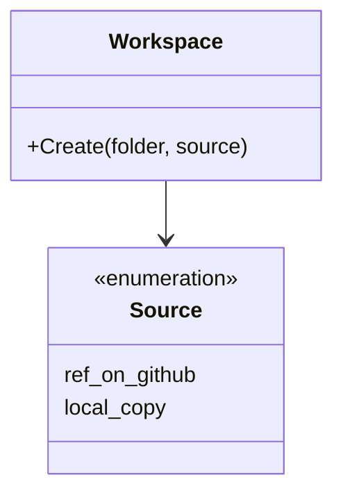
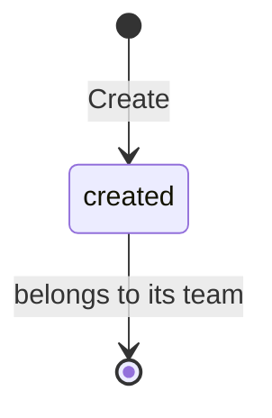

# Workspace specification

What a new workspace holds and where it comes from. It holds no knowledge of
any service or flow.

## Model

A workspace is a new folder. It is created once, from one source, and holds
the shared files and the sample. After that it belongs to its team; nothing in
this artifact changes it again.

## Rules

| ID | Rule | Error |
| --- | --- | --- |
| WS-1 | A workspace is created only in a folder that does not exist. When the folder exists, nothing is created or changed. | `ErrFolderExists` |
| WS-2 | The source is the framework at one ref on GitHub: a branch, a tag or a commit, `main` when none is given. When the setting `AD_SOURCE` names a local copy of the framework, that copy is the source and nothing is downloaded. | — |
| WS-3 | A workspace holds the shared files of its source as the source has them: `.agents`, `.claude`, `.editorconfig`, `.gitignore`, `AGENTS.md`, `CLAUDE.md`, `CONTRIBUTING.md`, `docs`, `scripts`, and the README of `services`, `apps` and `e2e`. | — |
| WS-4 | In place of what belongs to the framework itself, a workspace holds the sample: its `README.md`, `artifact-driven.json`, knowledge folder, domain map, and the README of `services` and `apps`. It holds no knowledge of the framework. | — |
| WS-5 | A workspace holds nothing else of its source: not the framework's tests, the folder the sample comes from, `install.sh` or the landing page. | — |
| WS-6 | When the source cannot be read, such as a ref that does not exist or no network, no folder is created. | `ErrNoSource` |
| WS-7 | Creating a workspace leaves nothing outside its folder: a downloaded copy of the source is removed when the creation ends (SYS-4). | — |
| WS-8 | A workspace is not a Git repository when it is created. Its team makes it one. | — |

## Lifecycle

## Open questions

- A creation that fails after the folder is made, such as an `AD_SOURCE`
  that does not exist or a copy that stops half way, leaves that folder in
  place with part of the files (WS-1, WS-6). Whether it must remove the
  folder.
- With `AD_SOURCE`, every file of the local copy is copied, also files that
  Git ignores there, such as caches and editor files (WS-2, WS-3). Whether
  only the files Git tracks may be copied.

Return to [Workspace](README.md).
