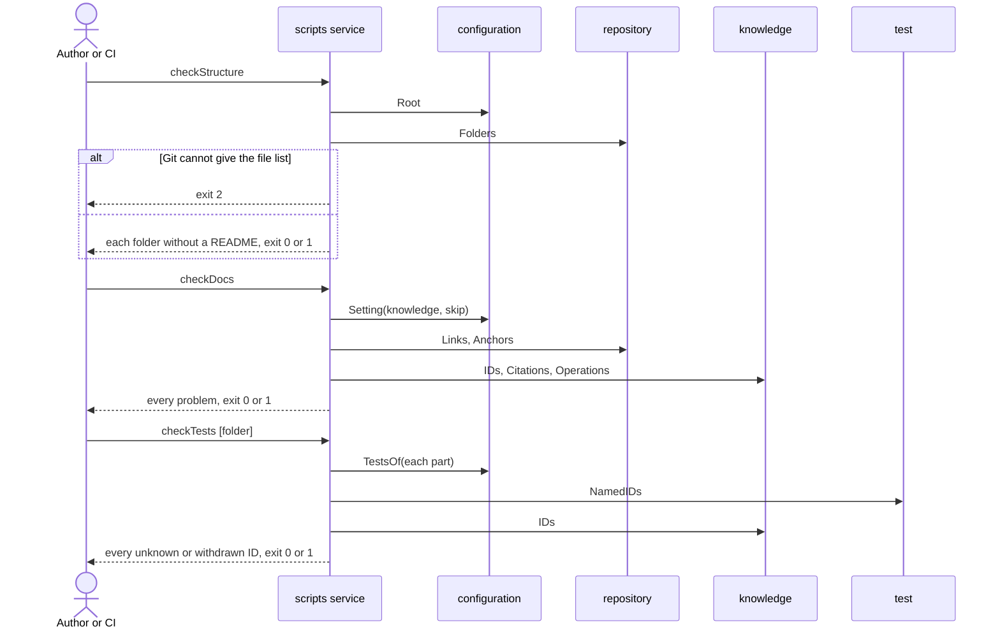

# Flow: Check a change

The author of a change, and CI on each pull request, run the checks. A change
with broken knowledge or broken tests fails them.

- Crosses: [configuration](../artifacts/configuration/README.md),
  [repository](../artifacts/repository/README.md),
  [knowledge](../artifacts/knowledge/README.md) and
  [test](../artifacts/test/README.md), served by the `scripts` service.
- Contract: `checkStructure` in the
  [repository contract](../artifacts/repository/openapi.yaml), `checkDocs` in
  the [knowledge contract](../artifacts/knowledge/openapi.yaml), and
  `checkTests` in the [test contract](../artifacts/test/openapi.yaml).
- Trigger: the author runs the checks before review, and CI runs them on each
  pull request into the default branch.
- Outcome: the change passes every check, or each check lists every problem
  it found and fails.

## Steps

1. The author, or CI, runs `checkStructure` in the workspace. The `scripts`
   service finds the root (CFG-1), asks Git for the file list and lists each
   folder without a README (REPO-1).
2. The author, or CI, runs `checkDocs`. The `scripts` service reads the
   configuration (CFG-2, CFG-3) and:
   1. checks the links and the anchors of every page (REPO-2, REPO-3);
   2. in the knowledge folder, reads the knowledge IDs (KN-1) and checks that
      each one is defined once (KN-2), not withdrawn where it is cited
      (KN-3), and defined where it is named (KN-4);
   3. classifies Flow-rule definitions and checks their scope, owner and
      required content (KN-13), then checks citation direction (KN-18);
   4. checks that each contract is the contract of an artifact or of the
      system (KN-19);
   5. checks that each scenario names an operation and each operation has a
      scenario (KN-6).
3. For a change to the code of a part, the author, or CI, runs `checkTests`
   with the tests of every part (CFG-4, CFG-5), or with the folder of the
   change. The `scripts` service reads the IDs each test file names (TST-1)
   and lists each one the knowledge does not hold (TST-2).
4. Each check prints every problem it found and exits with its status
   (SYS-3). CI stops the merge when a check fails.

## Scenarios

| ID | Given | When | Then | Covers |
| --- | --- | --- | --- | --- |
| F-CHECK-1 | A workspace where every folder that counts has a README | The author runs `checkStructure` from a folder under the root | It exits with 0 and prints the number of folders it checked | REPO-1, CFG-1, SYS-2, SYS-3 |
| F-CHECK-2 | Two folders with files and no README | The author runs `checkStructure` | It exits with 1 and names the two missing READMEs | REPO-1, SYS-3 |
| F-CHECK-3 | A folder that is not a Git repository, or no Git | The author runs `checkStructure` | It exits with 2 and says Git cannot give the file list | REPO-1, SYS-3 |
| F-CHECK-4 | A folder that Git ignores, with files and no README | The author runs `checkStructure` | It exits with 0 | REPO-1 |
| F-CHECK-5 | A page with a relative link to a file that does not exist | The author runs `checkDocs` | It exits with 1 and names the page and the link | REPO-2 |
| F-CHECK-6 | A link to a heading that the page it points to does not have | The author runs `checkDocs` | It exits with 1 and names the page and the anchor | REPO-3 |
| F-CHECK-7 | A page in the knowledge folder that names an ID no row defines, including a Flow-rule reference with a known or unknown scope | The author runs `checkDocs` | It exits with 1 and names the page and the ID | KN-1, KN-4 |
| F-CHECK-8 | One ID defined by rows on two pages, including duplicate local or shared Flow-rule definitions | The author runs `checkDocs` | It exits with 1 and names both pages | KN-2 |
| F-CHECK-9 | A withdrawn ID that another row names, including a withdrawn Flow rule | The author runs `checkDocs` | It exits with 1 and names the page and the ID | KN-3 |
| F-CHECK-10 | A flow that names a goal criterion, and an artifact that names a flow scenario | The author runs `checkDocs` | It exits with 1 and names each page and what it cites | KN-18 |
| F-CHECK-11 | A scenario that names no operation, and a command under `x-commands` that no scenario names | The author runs `checkDocs` | It exits with 1 and names the scenario and the command | KN-6 |
| F-CHECK-12 | A broken link in a page under a folder that the configuration skips | The author runs `checkDocs` | It exits with 0 | REPO-2, CFG-3 |
| F-CHECK-13 | A test file that names an ID with a full prefix the knowledge uses, including a known Flow-rule scope, and no row defines the ID | The author runs `checkTests` | It exits with 1 and names the file and the ID | TST-1, TST-2 |
| F-CHECK-14 | A test file that names a withdrawn ID, including a withdrawn Flow rule | The author runs `checkTests` | It exits with 1 and names the file and the ID | TST-2 |
| F-CHECK-15 | A test file that names an ID with a full prefix no defined ID has, including an unknown Flow-rule scope when another scope is defined | The author runs `checkTests` | It exits with 0 | TST-2 |
| F-CHECK-16 | Parts with a tests setting, and no tests folder of any of them exists | The author runs `checkTests` with no folder | It exits with 2 and says no part's tests folder exists, so a job that did not clone the parts fails | TST-6, CFG-5, SYS-3 |
| F-CHECK-17 | A folder that does not exist | The author runs `checkTests` with that folder | It exits with 2 and says it is not a folder | SYS-3 |
| F-CHECK-18 | A change with a broken link, an ID that is not defined and a scenario with no operation | The author runs `checkDocs` once | It lists all three problems in one run | SYS-3 |
| F-CHECK-19 | Any workspace | The author runs `checkStructure`, `checkDocs` and `checkTests` | No file of the workspace changes | SYS-4 |
| F-CHECK-20 | A configuration that gives no `knowledge` and no `skip` | The author runs `checkDocs` | It checks the IDs in `docs/software-knowledges` and reads no page under `.git`, `node_modules` or `build` | CFG-2 |
| F-CHECK-21 | A configuration that is not valid JSON on its third line | The author runs `checkStructure`, `checkDocs` and `checkTests` | Each exits with 2 and one line that names `artifact-driven.json`, line 3 and the column, with no Python traceback | CFG-7, SYS-3 |
| F-CHECK-22 | A page with two headings `Rules`, and links to `#rules`, `#rules-1` and `#rules-2` | The author runs `checkDocs` | It names only the link to `#rules-2` as a missing anchor | REPO-3 |
| F-CHECK-23 | A configuration that gives no part a tests setting | The author runs `checkTests` with no folder | It exits with 0 and says there are no tests to check | TST-6 |
| F-CHECK-24 | A page that writes `EN-301549`, the name of a standard, and no row that defines it | The author runs `checkDocs`, then lists `EN` under `standards` and runs it again | The first run names `EN-301549` as cited and not defined; the second passes | KN-1, CFG-9, KN-4 |
| F-CHECK-25 | Valid local and shared Flow-rule sections with distinct scopes, owners and explicit dependencies on artifact rules and system requirements; scenarios cite their local or shared rules and name operations | The author runs `checkDocs`, then `checkTests` on tests that name the defined rules | Both checks pass without a new configuration setting; the rules need no operation of their own | KN-2, KN-6, KN-13, KN-18, TST-2 |
| F-CHECK-26 | Coordination rules in a valid Flow home with a missing required column, an invalid Flow-rule ID, an empty rule or dependency cell, or the same scope defined in different homes | The author runs `checkDocs` | It exits with 1 and identifies each invalid definition and its page | KN-13, SYS-3 |
| F-CHECK-27 | A Flow rule depends on another Flow rule, a scenario or a goal; an artifact cites a Flow rule; a goal uses a Flow rule as Proven by; or an operation is named only by a Flow rule | The author runs `checkDocs` | It exits with 1 and identifies each forbidden dependency or missing scenario proof | KN-18, KN-6, SYS-3 |
| F-CHECK-28 | A previously valid workspace with FR-shaped artifact definitions outside the Flow-rule form, including a Coordination rules heading on an artifact page | The author runs `checkDocs` and `checkTests` with its existing tests | Both retain their previous result; no definition is reclassified as a Flow rule and no migration is required | KN-2, KN-13, TST-2 |
| F-CHECK-29 | A contract in `flows/`, with either the `.yaml` or `.yml` extension | The author runs `checkDocs` | It exits with 1 and names the file as a contract that belongs to an artifact or the system | KN-19, SYS-3 |

Return to [flows](README.md).
