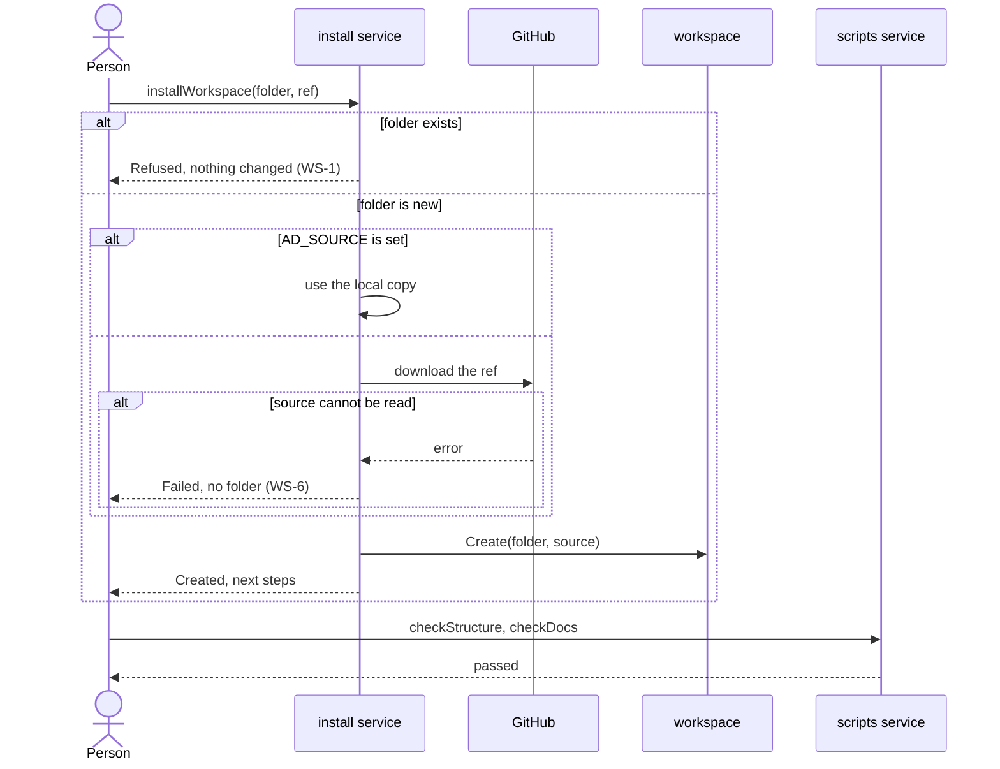

# Flow: Install a workspace

A person creates a workspace with one command and checks it.

- Crosses: [workspace](../artifacts/workspace/README.md), served by the
  `install` service; [repository](../artifacts/repository/README.md) and
  [knowledge](../artifacts/knowledge/README.md), served by the `scripts`
  service.
- Contract: `installWorkspace` in the
  [workspace contract](../artifacts/workspace/openapi.yaml), `checkStructure`
  in the [repository contract](../artifacts/repository/openapi.yaml), and
  `checkDocs` in the
  [Check a change contract](check-change.openapi.yaml).
- Trigger: a person who starts a project runs `installWorkspace` in a shell.
- Outcome: a new workspace that holds the shared files and the sample, or
  nothing at all.

## Steps

1. The person runs `installWorkspace` with a folder, and a ref or
   `AD_SOURCE` when they want another source than `main` (WS-2).
2. The `install` service refuses a folder that exists (WS-1).
3. The `install` service reads the source: it downloads the ref from GitHub,
   or uses the local copy (WS-2). When it cannot read the source, it stops
   before it creates the folder (WS-6).
4. The `install` service creates the folder, copies the shared files into it
   (WS-3), and puts the sample in place of what belongs to the framework
   (WS-11, WS-5). It removes the downloaded copy (WS-7).
5. The `install` service prints the next steps. The person enters the folder
   and makes it a Git repository (WS-8).
6. The person runs `checkStructure` and `checkDocs` in the new workspace. The
   `scripts` service checks it as it checks any workspace.

## Scenarios

| ID | Given | When | Then | Covers |
| --- | --- | --- | --- | --- |
| F-START-1 | A folder that does not exist | The person runs `installWorkspace` with the folder | The folder holds the shared files and the sample, and the output names the next steps | WS-3, WS-11 |
| F-START-2 | A folder that exists | The person runs `installWorkspace` with the folder | The command exits with a status other than 0, says the folder exists, and the folder is unchanged | WS-1 |
| F-START-3 | `AD_SOURCE` names a local copy of the framework | The person runs `installWorkspace` | The workspace is copied from the local copy and nothing is downloaded | WS-2 |
| F-START-4 | No ref, then a tag as the ref | The person runs `installWorkspace` each time | The first workspace comes from `main`, the second from the tag | WS-2 |
| F-START-5 | A new workspace | The person reads its knowledge folder and its files after `installWorkspace` | It holds the knowledge of the sample only: no knowledge, tests or landing page of the framework, and no `install.sh` | WS-11, WS-5 |
| F-START-6 | A new workspace that its team made a Git repository | The person runs `checkStructure` and `checkDocs` after `installWorkspace` | Both checks exit with 0 | WS-3, WS-11, WS-8, REPO-1, REPO-2, REPO-3, KN-4, KN-6 |
| F-START-7 | A ref that does not exist on GitHub, or no network | The person runs `installWorkspace` | The command exits with a status other than 0 and no folder exists | WS-6 |
| F-START-8 | A download from GitHub | `installWorkspace` ends, with or without success | Nothing it downloaded is left outside the new folder | WS-7, SYS-4 |
| F-START-9 | A machine with `sh`, `curl` and `tar`, and no other tool | The person runs `installWorkspace` | The workspace is created | SYS-1 |
| F-START-10 | `AD_SOURCE` that names no folder, then a local copy with no `template` folder, which stops the copy half way | The person runs `installWorkspace` each time | Each exits with a status other than 0; neither the folder given nor any folder beside it is left | WS-9, WS-6 |
| F-START-11 | `AD_SOURCE` that is a Git working tree with a file Git ignores, such as `scripts/__pycache__/check.pyc` | The person runs `installWorkspace` | The workspace has every file the copy tracks and not the ignored one | WS-10, WS-2 |

Return to [flows](README.md).
