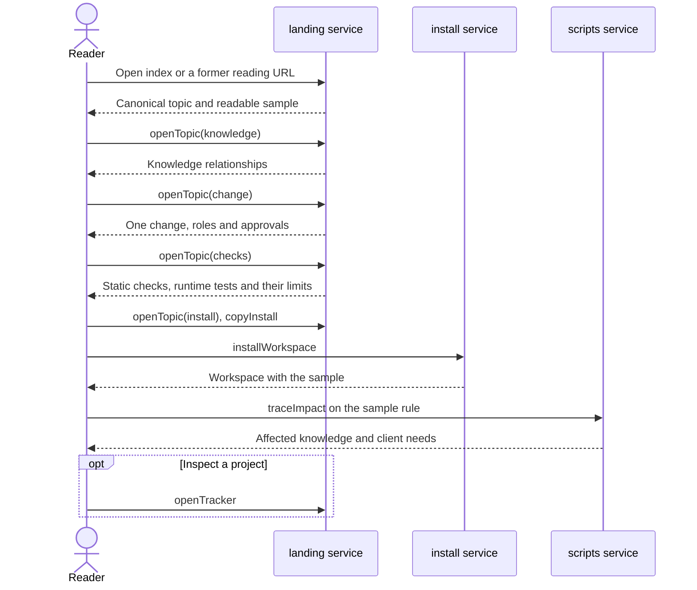

# Flow: Learn the framework

A reader who does not read the repository learns what the framework is, how
its knowledge fits together, how a team makes one change, what checks mean,
and how to start.

- Crosses: [introduction](../artifacts/introduction/README.md),
  [guide](../artifacts/guide/README.md),
  [method](../artifacts/method/README.md) and
  [agents](../artifacts/agents/README.md), served by the `landing` service;
  [workspace](../artifacts/workspace/README.md), served by the `install`
  service; and [knowledge](../artifacts/knowledge/README.md), served by the
  `scripts` service.
- Contract: `openTopic`, `openFramework`, `openMethod`, `openAgents`,
  `copyInstall` and `openTracker` in the
  [introduction contract](../artifacts/introduction/openapi.yaml),
  `installWorkspace` in the
  [workspace contract](../artifacts/workspace/openapi.yaml), and
  `traceImpact` in the
  [knowledge contract](../artifacts/knowledge/openapi.yaml).
- Trigger: a stakeholder, a solution architect, a product owner or an
  implementer opens the reading path or a former reading-page URL.
- Outcome: the reader understands the knowledge and the roles in a change,
  distinguishes static traceability from runtime evidence, and can open the
  project tracker or create a workspace.

## Steps

1. The reader opens the canonical reading path or follows a former URL to
   its matching topic with `openFramework`, `openMethod` or `openAgents`
   (SYS-8). The `landing` service presents the sample and the knowledge
   explanation (INTRO-2, INTRO-10).
2. The reader follows the path or uses `openTopic` to choose a topic
   (SYS-8). The worked change shows the method and the work of people and
   agents (MTH-1, MTH-9, MTH-11, AGT-11, AGT-12). The reader can run
   `traceImpact` against the sample to inspect its dependencies (INTRO-4).
3. The reader opens Checks with `openTopic` to learn the limits of the scan
   and the tests each layer needs (INTRO-3, MTH-7). The page connects common
   tasks to their resources (INTRO-19).
4. The reader opens reference details when needed: terms (MTH-4), workspace
   files and framework parts (AGT-1, GUIDE-5, GUIDE-2), or tool guidance
   (AGT-6, AGT-9).
5. The reader opens the separate project tracker with `openTracker`, or
   copies the install command with `copyInstall` and runs `installWorkspace`
   in a shell. The `install` service creates the workspace with the sample
   (WS-4). The reader can try the supplied prompt with their own agent and
   check its work against the governance (AGT-13).

## Scenarios

| ID | Given | When | Then | Covers |
| --- | --- | --- | --- | --- |
| F-LEARN-1 | Withdrawn. The seven-step autoplay story is removed. | — | — | — |
| F-LEARN-2 | Withdrawn. Stopping an animated story is no longer an action. | — | — | — |
| F-LEARN-3 | Withdrawn. The reading path has no autoplay state. | — | — | — |
| F-LEARN-4 | A reader at the reading path | The reader calls `openTopic` with `checks` | The page says that the scan finds IDs in test files without running tests; a named ID does not prove correct behavior or a passing test; any illustrative scan result is labeled as an example | INTRO-2, INTRO-3 |
| F-LEARN-5 | The sample examples on the reading path | The reader runs `installWorkspace` and opens the sample in the new workspace | Every goal, flow, knowledge ID, artifact and client used in the examples exists there, with the relationships the page describes | INTRO-2, WS-4 |
| F-LEARN-6 | The whole reading path and its reference details | The reader calls `openTopic` for each topic and reads the details | No text states the cost or duration of a change, a plan or a status; any claimed script result can be reproduced on the sample | INTRO-2, INTRO-4 |
| F-LEARN-7 | Withdrawn: moved to F-LEARN-17. | — | — | — |
| F-LEARN-8 | A folder that does not exist | The reader calls `copyInstall` and runs the copied command in a shell, which calls `installWorkspace` | A workspace is created in that folder from main | WS-1, WS-2, WS-4 |
| F-LEARN-9 | Withdrawn: moved to F-LEARN-25. | — | — | — |
| F-LEARN-10 | The page file served with no access to another host | The reader calls `openTopic` for each topic | The explanations and sample remain readable in the fonts of the system | INTRO-8 |
| F-LEARN-11 | Withdrawn. Hovering an animated block is no longer needed to read an explanation. | — | — | — |
| F-LEARN-12 | A technical reader with the former framework URL | The reader calls `openFramework` | The canonical file reference opens and explains the workspace files and framework parts | GUIDE-5, SYS-8 |
| F-LEARN-13 | The canonical framework reference | The reader calls `openFramework` and follows the link for each part | Each link leads to that part's governing page, and the explanation agrees with it | GUIDE-2, SYS-8 |
| F-LEARN-14 | Withdrawn: moved to F-LEARN-25. | — | — | — |
| F-LEARN-15 | The reading path and a workspace with the sample | The reader calls `openTopic`, follows the resources for the team tasks described, and runs an example such as `traceImpact` on the rule being changed | Each described task leads to a resource that handles it; the sample supports the examples and no claim states a cost, duration or speed | INTRO-19, INTRO-2, INTRO-4 |
| F-LEARN-16 | A reader with the former how-we-work URL | The reader calls `openMethod` | The canonical knowledge topic explains how a sample requirement becomes a goal, flows, artifact rules and tests; the worked change identifies the human roles | MTH-1, MTH-11, SYS-8 |
| F-LEARN-17 | A product owner and a solution architect | Each calls `openTopic` with `change` and reads the terms reference | Each can identify what they write, read or decide; the product owner approves the goal and each affected part's owner approves its share; familiar terms do not replace the framework's definitions | MTH-11, MTH-4 |
| F-LEARN-18 | Withdrawn: moved to F-LEARN-25. | — | — | — |
| F-LEARN-19 | Withdrawn: moved to F-LEARN-25. | — | — | — |
| F-LEARN-20 | A reader checking how knowledge is proved | The reader calls `openTopic` with `checks` and reads the diagram and test reference | The diagrams and tests of each layer agree with the governance; any suggested test-writing practice is distinguished from a requirement | MTH-7 |
| F-LEARN-21 | Withdrawn. Each step names the known practice it uses (MTH-10); a separate list of practices added nothing. | — | — | — |
| F-LEARN-22 | The reading path and a new workspace | The reader calls `openTopic` with `install`, opens the files reference and lists the workspace files | The project instructions, role definitions, skills and Claude Code links exist as described; any tools or models named agree with those files | AGT-1 |
| F-LEARN-23 | An agent operator with Claude Code or Codex | The reader calls `openAgents`, reads the change, and opens the limits and tools references | The change identifies roles, runbooks, agent work and human checks; limits agree with the governance; tool guidance distinguishes workspace instructions from tool capabilities and links official documentation | AGT-12, AGT-9, AGT-11, AGT-6, SYS-8 |
| F-LEARN-24 | The worked change and a workspace with the sample | The reader calls `openTopic` with `change` and runs `traceImpact` on the sample rule that sets a loan's due time | The example changes 14 to 21 days for new loans only and keeps existing due dates; roles and human checks are explicit; a skipped step has a reason; the page shows how to find affected flows, contracts and client needs, agrees with the impact output and does not call it a passing runtime test | AGT-12, INTRO-2, INTRO-4, KN-8 |
| F-LEARN-25 | A browser 360 px wide on a system that uses a dark theme | The reader calls `openTopic` for each topic, opens its reference details, and calls `openTracker` from the top and foot | The reading path stays light and needs no horizontal scrolling; top and foot topic links work and the tracker opens as a separate application | SYS-8 |
| F-LEARN-26 | A product owner clarifying a need | The reader calls `openTopic` with `change` and follows the runbook links | The example establishes the current rule and clarifies scope before writing knowledge; unresolved decisions lead to options, their effect on rules and questions for the owner; each link leads to its step's runbook | MTH-9 |
| F-LEARN-28 | An agent operator with Claude Code or Codex, and a new workspace | The reader calls `openTopic` with `install`, copies the sample-change prompt and gives it to their own agent | The prompt and linked checklist preserve clarification, knowledge before code, actual impact and check results, and human approval; no push, merge or agent result is promised | AGT-13 |
| F-LEARN-29 | A reader with or without reduced motion enabled | The reader calls `openTopic` for each topic directly, through the topic links and again after another topic | The five topics are reachable without autoplay; the sample explains System as shared, Goal citing Flow and Flow citing Artifact, with rules inside Artifact and contracts, client needs and tests as related dependencies | SYS-8, INTRO-10 |
| F-LEARN-30 | A former framework, how-we-work or agents URL, with no fragment, an old fragment or an unknown fragment | The reader calls `openFramework`, `openMethod` or `openAgents`, then follows another topic and uses browser Back and Forward | The entrypoint reaches its matching canonical topic or reference, known fragments keep their meaning, an unknown fragment uses the entrypoint's default, and linked details are open; repeated navigation and history leave the destination readable | SYS-8 |

Return to [flows](README.md).
