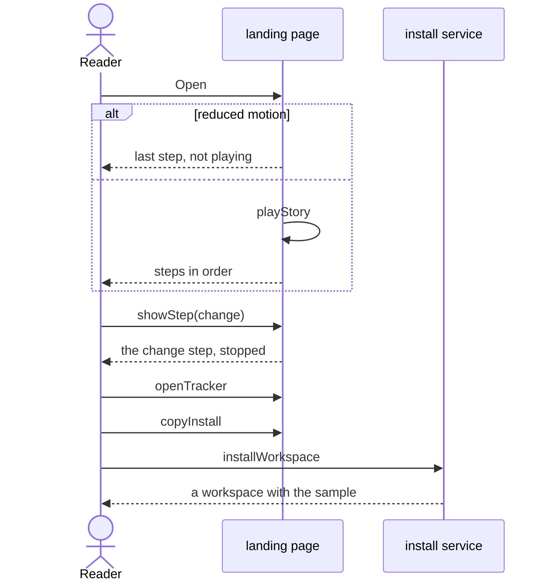

# Flow: Learn the framework

A reader who does not read the repository learns, from the landing page, how
a goal becomes flows, rules, artifacts, clients and tests, and where to go
next.

- Crosses: [introduction](../artifacts/introduction/README.md),
  [guide](../artifacts/guide/README.md),
  [method](../artifacts/method/README.md) and
  [agents](../artifacts/agents/README.md), served by the `landing` service,
  and [workspace](../artifacts/workspace/README.md), served by the `install`
  service.
- Contract: `playStory`, `showStep`, `explainBlock`, `openFramework`,
  `openMethod`, `openAgents`, `copyInstall` and `openTracker` in the
  [introduction contract](../artifacts/introduction/openapi.yaml),
  `installWorkspace` in the
  [workspace contract](../artifacts/workspace/openapi.yaml), and
  `traceImpact` in the
  [knowledge contract](../artifacts/knowledge/openapi.yaml).
- Trigger: a stakeholder, a solution architect or a product owner opens the
  landing page.
- Outcome: the reader has seen the story, knows where their questions are
  answered, and can open the project tracker or create a workspace.

## Steps

1. The page opens and calls `playStory`, unless the reader asks for reduced
   motion (INTRO-5). The story goes through its steps (INTRO-1), with the
   names and IDs of the sample (INTRO-2).
2. The reader picks a step with `showStep`. The story stops there (INTRO-5).
   The reader points at a block with `explainBlock` to read what it is
   (INTRO-9).
3. The reader reads the situations of a team's day (INTRO-14), then opens
   the how-we-work page with `openMethod`, the agents page with `openAgents`
   or the project tracker with `openTracker`. Every reading page links the
   others and the tracker (SYS-8).
4. A technical reader opens the framework page with `openFramework`, and
   reads what the framework holds (GUIDE-1, GUIDE-2).
5. The reader copies the install command with `copyInstall` and runs
   `installWorkspace` in a shell. The new workspace holds the sample that the
   story showed (WS-4).

## Scenarios

| ID | Given | When | Then | Covers |
| --- | --- | --- | --- | --- |
| F-LEARN-1 | A reader whose system does not ask for reduced motion | The reader opens the page, which calls `playStory` | Above the story the layers are named in order, each with one sentence; the story shows the seven steps in order, each with its sentence, and starts again after the last; below the story the situations of a team's day follow | INTRO-1, INTRO-5, INTRO-10, INTRO-14 |
| F-LEARN-2 | The story playing | The reader calls `showStep` with `change` | The story stops at the change step, which shows, from one rule, the flows and clients it affects and the clients it does not | INTRO-4, INTRO-5 |
| F-LEARN-3 | A reader whose system asks for reduced motion | The reader opens the page, which calls `playStory` | The story does not play and shows the change step | INTRO-5 |
| F-LEARN-4 | The story stopped | The reader calls `showStep` with `scan` and reads the page | The step says which rules the scan finds is an example, and the page says that a rule found is not proof that the code is right | INTRO-2, INTRO-3 |
| F-LEARN-5 | The story of the page | The reader runs `installWorkspace` and opens the sample in the new workspace | Every goal, flow, knowledge ID, artifact and client of the story is there, linked as the story links it | INTRO-2, WS-4 |
| F-LEARN-6 | The whole page | The reader calls `showStep` with each step and reads every card | No text states the cost or the duration of a change, a plan or a status | INTRO-4 |
| F-LEARN-7 | Withdrawn: moved to F-LEARN-17. | — | — | — |
| F-LEARN-8 | A folder that does not exist | The reader calls `copyInstall` and runs the copied command in a shell, which calls `installWorkspace` | A workspace is created in that folder from main | WS-1, WS-2, WS-4 |
| F-LEARN-9 | Withdrawn: moved to F-LEARN-25. | — | — | — |
| F-LEARN-10 | The page file served with no access to another host | The reader opens it, which calls `playStory` | The story plays through all its steps, in the fonts of the system | INTRO-8 |
| F-LEARN-11 | The story playing at the rule step | The reader points at a rule, which calls `explainBlock` | The rule is explained in plain words, and the story does not move on until the reader points away | INTRO-9, INTRO-5 |
| F-LEARN-12 | A solution architect on the landing page | The reader calls `openFramework` | The framework page says in a few paragraphs what the framework turns the governance into, lists its parts with one sentence each, what each workspace gets from them, and the files of a workspace | GUIDE-1 |
| F-LEARN-13 | The framework page | The reader calls `openFramework` and follows the link of each part | Each link leads to the rules of that part, and every name on the page exists in the framework | GUIDE-2, SYS-8 |
| F-LEARN-14 | Withdrawn: moved to F-LEARN-25. | — | — | — |
| F-LEARN-15 | The landing page and a workspace with the sample | The reader opens the page, which calls `playStory`, reads each situation, and runs what it names on the sample, such as `traceImpact` with the rule that only an available book can be lent | Each situation names its question, what answers it and an example; the impact of that rule lists 5 criteria, 10 scenarios, two flows and the phone app's page, as the page says; no situation states a cost, a duration or a speed | INTRO-14, INTRO-2, INTRO-4 |
| F-LEARN-16 | The landing page | The reader calls `openMethod` | The how-we-work page lists the steps to break a requirement down in order, each with its example and diagram, then the method behind them, then who does what | MTH-1, MTH-2, MTH-3 |
| F-LEARN-17 | A product owner and a solution architect on the how-we-work page | Each calls `openMethod` and reads their own lane | The product owner's lane writes the need and the criteria, answers the open questions and approves the goal; the solution architect's lane writes the flows, rules, artifacts and contracts and checks their impact; the owner of each service approves what it serves; each finds the word of their trade for each layer | MTH-3, MTH-4 |
| F-LEARN-18 | Withdrawn: moved to F-LEARN-25. | — | — | — |
| F-LEARN-19 | Withdrawn: moved to F-LEARN-25. | — | — | — |
| F-LEARN-20 | A solution architect on the how-we-work page | The reader calls `openMethod` and reads the last column of each step | Each step names the diagram its layer has and the tests that prove it as the rules say, and BDD, TDD and contract tests carry a label that says they are suggested | MTH-7 |
| F-LEARN-21 | Withdrawn. Each step names the known practice it uses (MTH-2); a separate list of practices added nothing. | — | — | — |
| F-LEARN-22 | The landing page and a new workspace | The reader calls `openAgents`, then lists the files of the workspace | The agents page names the project instructions, the agent of each role with its tools and model, the skills and the links for Claude Code, and each one is in the workspace | AGT-1 |
| F-LEARN-23 | An agent operator on the agents page, with Claude Code or with Codex | The reader calls `openAgents` and reads each step of the work, the team and the part of their tool | Each step names its runbook, what the person decides, what the agent does with a prompt, and what the person checks; at the step that pulls out rules the agent only proposes; the flow of the team is in the order of the team page, with its limits; the reference says what the tool reads from the workspace and how a session hands each step to the agent of its role, and each fact about the tool links the tool's own documentation | AGT-8, AGT-9, AGT-4, AGT-6 |
| F-LEARN-24 | The agents page and a workspace with the sample | The reader follows the change of the default loan period and runs `traceImpact` with the rule that sets the due time of a loan | Each step names its role, what it runs and what it passes on; the contract designer shows as skipped because no shape changes; the impact lists 6 criteria, 14 scenarios and the phone app's page, as the page says | AGT-5, KN-8 |
| F-LEARN-25 | Each reading page, in a browser 360 px wide on a system that uses a dark theme | The reader opens the landing page, calls `openFramework`, `openMethod` and `openAgents`, and from the top and the foot of each calls `openTracker` | Each page stays light and needs no horizontal scrolling; its top and its foot link each other reading page and the project tracker, which opens | SYS-8 |
| F-LEARN-26 | A product owner with a vague need, on the how-we-work page | The reader calls `openMethod`, reads the step before the goal, and follows the runbook link of each step | The step shows, on the sample's example, what holds today, the options with the IDs each one keeps, changes or adds, and the questions about the option chosen; each link leads to the runbook of its step | MTH-9 |
| F-LEARN-28 | An agent operator with Claude Code or Codex, and a new workspace | The reader calls `openAgents`, copies the prompt of the change of the default loan period and gives it to their own agent | The page lists what to watch for, each point linked to the governance that asks for it, and states no result the agent will give; the reader judges the run by that list | AGT-10 |

Return to [flows](README.md).
