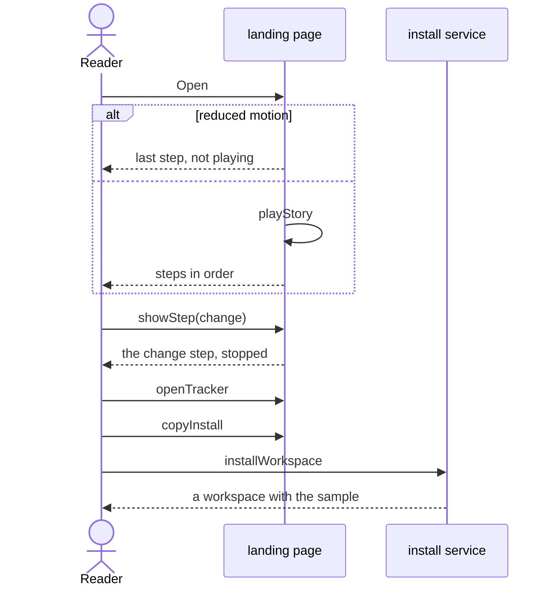

# Flow: Learn the framework

A reader who does not read the repository learns, from the landing page, how
a goal becomes flows, rules, artifacts, clients and tests, and where to go
next.

- Crosses: [introduction](../artifacts/introduction/README.md), served by the
  `landing` service, and [workspace](../artifacts/workspace/README.md),
  served by the `install` service.
- Contract: `playStory`, `showStep`, `copyInstall` and `openTracker` in the
  [introduction contract](../artifacts/introduction/openapi.yaml), and
  `installWorkspace` in the
  [workspace contract](../artifacts/workspace/openapi.yaml).
- Trigger: a stakeholder, a solution architect or a product owner opens the
  landing page.
- Outcome: the reader has seen the story, knows where their questions are
  answered, and can open the project tracker or create a workspace.

## Steps

1. The page opens and calls `playStory`, unless the reader asks for reduced
   motion (INTRO-5). The story goes through its steps (INTRO-1), with the
   names and IDs of the sample (INTRO-2).
2. The reader picks a step with `showStep`. The story stops there (INTRO-5).
   The reader points at a block with `explainBlock` to read what it is
   (INTRO-9).
3. The reader reads the card for their role and follows the link of a
   question (INTRO-6), such as `openTracker`.
4. The reader copies the install command with `copyInstall` and runs
   `installWorkspace` in a shell. The new workspace holds the sample that the
   story showed (WS-4).

## Scenarios

| ID | Given | When | Then | Covers |
| --- | --- | --- | --- | --- |
| F-LEARN-1 | A reader whose system does not ask for reduced motion | The reader opens the page, which calls `playStory` | Above the story the layers are named in order, each with one sentence; the story shows the seven steps in order, each with its sentence, and starts again after the last; below the story the steps to break a requirement down are listed in order, followed by the method behind them | INTRO-1, INTRO-5, INTRO-10, INTRO-11, INTRO-12 |
| F-LEARN-2 | The story playing | The reader calls `showStep` with `change` | The story stops at the change step, which shows, from one rule, the flows and clients it affects and the clients it does not | INTRO-4, INTRO-5 |
| F-LEARN-3 | A reader whose system asks for reduced motion | The reader opens the page, which calls `playStory` | The story does not play and shows the change step | INTRO-5 |
| F-LEARN-4 | The story stopped | The reader calls `showStep` with `scan` and reads the page | The step says which rules the scan finds is an example, and the page says that a rule found is not proof that the code is right | INTRO-2, INTRO-3 |
| F-LEARN-5 | The story of the page | The reader runs `installWorkspace` and opens the sample in the new workspace | Every goal, flow, knowledge ID, artifact and client of the story is there, linked as the story links it | INTRO-2, WS-4 |
| F-LEARN-6 | The whole page | The reader calls `showStep` with each step and reads every card | No text states the cost or the duration of a change, a plan or a status | INTRO-4 |
| F-LEARN-7 | A stakeholder, a solution architect and a product owner | Each reads their card and calls `openTracker` from it | Each question of the card links to the page that answers it, and the tracker opens | INTRO-6 |
| F-LEARN-8 | A folder that does not exist | The reader calls `copyInstall` and runs the copied command in a shell, which calls `installWorkspace` | A workspace is created in that folder from main | WS-1, WS-2, WS-4 |
| F-LEARN-9 | A browser 360 px wide, on a system that uses a dark theme | The reader opens the page and calls `showStep` with each step | The page stays light, every step reads, and the page needs no horizontal scrolling | INTRO-7 |
| F-LEARN-10 | The page file served with no access to another host | The reader opens it, which calls `playStory` | The story plays through all its steps, in the fonts of the system | INTRO-8 |
| F-LEARN-11 | The story playing at the rule step | The reader points at a rule, which calls `explainBlock` | The rule is explained in plain words, and the story does not move on until the reader points away | INTRO-9, INTRO-5 |

## Open questions

- Which address `openTracker` opens, and which workspace the tracker shows
  first (INTRO-6).

Return to [flows](README.md).
