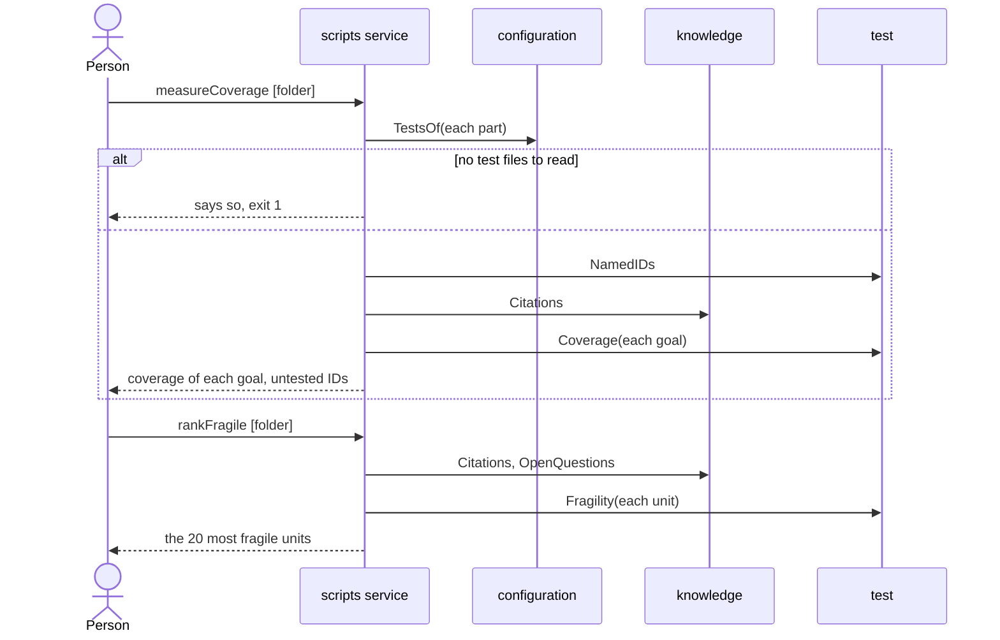

# Flow: Measure coverage

A person sees which knowledge IDs the tests of the parts name, for each goal,
and which units are proved least.

- Crosses: [configuration](../artifacts/configuration/README.md),
  [knowledge](../artifacts/knowledge/README.md) and
  [test](../artifacts/test/README.md), served by the `scripts` service.
- Contract: `measureCoverage` and `rankFragile` in the
  [test contract](../artifacts/test/openapi.yaml).
- Trigger: a person wants to know how much of the knowledge the tests name,
  such as before a release or when choosing what to test next.
- Outcome: for each goal, the share of its IDs that tests name and the IDs no
  test names; and the units a change would break most and that are proved
  least.

## Steps

1. The person runs `measureCoverage`, with a tests folder or without one. The
   `scripts` service reads the test files of every part whose tests folder
   exists, or of the folder given (CFG-4, CFG-5), and the IDs each one names
   (TST-1, TST-3).
2. For each goal, the `scripts` service takes the criteria of the goal and
   what they rely on (KN-9), and prints their coverage and the IDs no test
   names (TST-4). It ends with the coverage of every ID in the knowledge.
3. The person runs `rankFragile`, with a tests folder or without one. The
   `scripts` service scores each requirement, rule, operation and schema
   (TST-7, KN-8, KN-12) and prints the 20 most fragile.

## Scenarios

| ID | Given | When | Then | Covers |
| --- | --- | --- | --- | --- |
| F-COVER-1 | A goal that relies on 2 criteria, 4 scenarios and 4 rules, and test files that name 1 criterion, 2 scenarios and 3 rules of them | The person runs `measureCoverage` with the tests folder | The goal shows 60%, criteria 1/2, scenarios 2/4 and rules 3/4, and lists the 4 IDs no test names | TST-1, TST-3, TST-4, KN-9 |
| F-COVER-2 | A test that fails, and that names a rule in a comment only | The person runs `measureCoverage` | The rule counts as tested | TST-1, TST-3, SYS-6 |
| F-COVER-3 | A withdrawn rule, and a rule that no goal relies on | The person runs `measureCoverage` | The line for the whole knowledge counts the second rule and not the first | TST-4 |
| F-COVER-4 | No folder given, and no tests folder of any part exists | The person runs `measureCoverage` | It exits with 1 and says to pass a folder or clone a part | CFG-5, SYS-3 |
| F-COVER-5 | Two services and the end-to-end tests with tests settings, and the tests folders of one service and of the end-to-end tests exist | The person runs `measureCoverage` with no folder | It reads the test files of that service and of the end-to-end tests, each with its own glob | CFG-4, CFG-5 |
| F-COVER-6 | The tests folder of a part, and a folder that is the tests folder of no part | The person runs `measureCoverage` with each | The first is read with the glob of the part, the second with the default glob | CFG-4 |
| F-COVER-7 | No tests folder, and two rules with the same reach, one that a scenario cites and one that none cites | The person runs `rankFragile` | The rule that no scenario cites ranks above the other, and each line shows `-` for tests | TST-7 |
| F-COVER-8 | A tests folder, a rule that no test names, and an operation that an open question names | The person runs `rankFragile` with the folder | The rule shows 0 tests and counts as weaker; the operation is marked as having an open question and scores 8 more | TST-7, KN-12 |
| F-COVER-9 | Any workspace and its tests | The person runs `measureCoverage` or `rankFragile` | No test runs and no file changes | SYS-4, SYS-6 |
| F-COVER-10 | Two parts whose tests folders are `tests/a` and `tests/b`, each with its own glob, and test files that only those globs match | The person runs `measureCoverage` with `tests` | It reads the test files of both parts, each with its part's glob | CFG-8, CFG-4 |
| F-COVER-11 | Three system requirements, and test files that name one of them | The person runs `measureCoverage` | The goals' shares are as before, and a line for the requirements shows 1/3 and the two no test names | TST-4 |
| F-COVER-12 | A goal relies on 1 criterion, 1 scenario, 1 artifact rule and 2 Flow rules; tests name only one Flow rule; another Flow rule is withdrawn | The person runs `measureCoverage` with those tests | The goal shows 20%, criteria 0/1, scenarios 0/1 and rules 1/3; the withdrawn rule is excluded from the whole-knowledge count, and naming a Flow rule supplies no scenario proof | TST-3, TST-4, KN-9, KN-13 |

Return to [flows](README.md).
