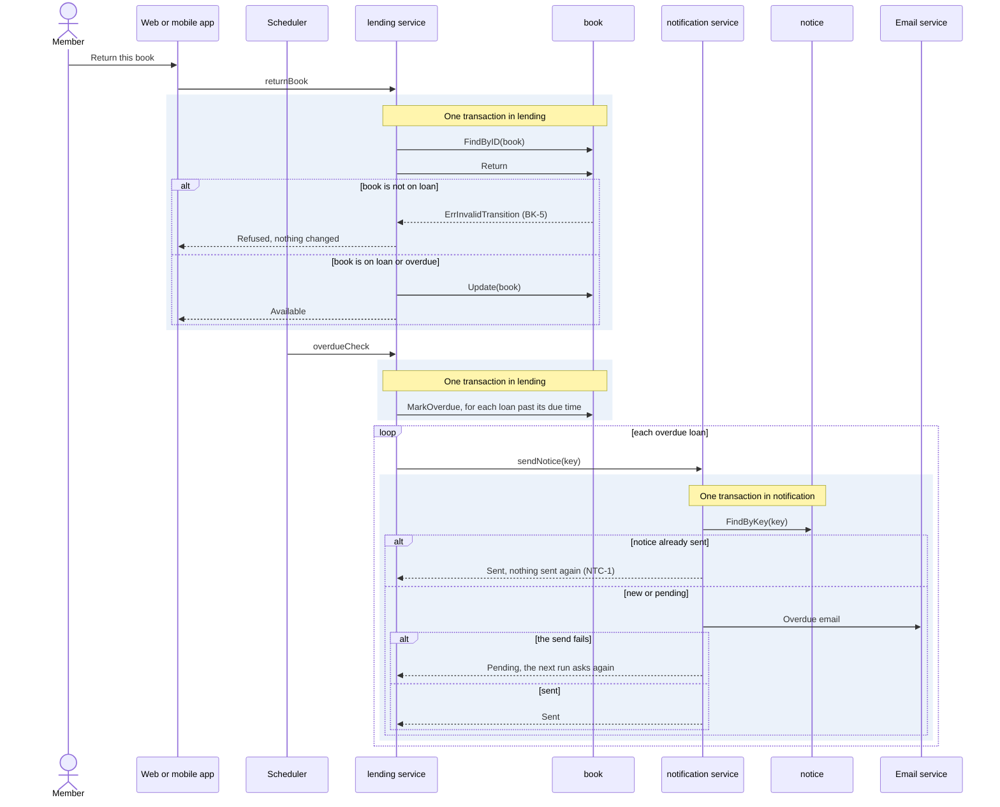

# Flow: Return a book

Reference flow with a worker and a second service. It shows a flow that a
schedule starts and that calls another service after its transaction.

- Crosses: [book](../artifacts/book/README.md) and
  [member](../artifacts/member/README.md), served by the `lending` service;
  [notice](../artifacts/notice/README.md), served by the `notification`
  service.
- Contract: `returnBook`, the trigger `overdueCheck` and the overdue email
  payload, in [return-book.openapi.yaml](return-book.openapi.yaml), and
  `sendNotice` in the [notice contract](../artifacts/notice/openapi.yaml).
- Trigger: a member returns a book on the web or the mobile app, or
  `overdueCheck`, which the scheduler fires every day at 02:00 in the
  library's time zone.
- Outcome: the book is available again, or a late loan is overdue and the
  member is told once.

## Steps

### Return

1. The member returns the book. The client asks the `lending` service to end
   the loan (`returnBook`).
2. In one transaction, the `lending` service loads the book from `book` under
   BK-8, ends the loan under BK-5 and BK-10, and stores the book. The member's
   count of loans in `member` drops with it (MBR-2).
3. The `lending` service answers with the book, now available.

### Overdue

1. The scheduler fires `overdueCheck`, and the overdue worker of the `lending`
   service runs.
2. In one transaction, the worker finds every loan past its due time and marks
   the book overdue, under BK-6. From then on the member may not borrow
   (MBR-4).
3. After the transaction, for every overdue loan, the worker asks the
   `notification` service to send the overdue email (`sendNotice`), with a key
   made of the book and its due time. When the call fails, the book stays
   overdue, and the next run asks again with the same key.
4. In the `notification` service, the notice is sent once per key (NTC-1): a
   request for a notice already sent sends nothing, and a request for a notice
   whose email failed tries again.
5. When the same trigger arrives twice, the second run marks nothing new, and
   its requests send nothing (SYS-8).

## Scenarios

| ID | Given | When | Then | Covers |
| --- | --- | --- | --- | --- |
| F-RETURN-1 | A book on loan | The member calls `returnBook` | The book is available | BK-5 |
| F-RETURN-2 | An available book | The member calls `returnBook` | The return is refused | BK-5 |
| F-RETURN-3 | A book on loan past its due time | `overdueCheck` fires | The book is overdue and the member gets the overdue email | BK-6, NTC-2, SYS-5 |
| F-RETURN-4 | An overdue book | The member calls `returnBook`, then `borrowBook` on another book | The first book is available and the second loan goes through | BK-5, MBR-4 |
| F-RETURN-5 | An overdue book | The member calls `getBook` | The status is overdue and the due time is the one that passed | BK-6 |
| F-RETURN-6 | A book on loan to another member | The member calls `returnBook` | The return is refused and the loan goes on | BK-10 |
| F-RETURN-7 | No loan past its due time | `overdueCheck` fires | Nothing changes and no email is sent | BK-6 |
| F-RETURN-8 | A book on loan past its due time, and an email service that fails | `overdueCheck` fires, then fires again the next day with the service back | The book is overdue after the first run; the member gets one overdue email, after the second run | BK-6, NTC-1 |
| F-RETURN-9 | A book that the last run marked overdue and emailed about | `overdueCheck` fires again with the same `run_at` | Nothing changes and no second email is sent | BK-6, NTC-1, SYS-8 |
| F-RETURN-10 | A book on loan past its due time, and a `notification` service that does not answer | `overdueCheck` fires, then fires again the next day with the service back | The book is overdue after the first run; the member gets one overdue email, after the second run | BK-6, NTC-1, SYS-8 |
| F-RETURN-11 | An overdue email already sent for a loan | The `lending` service calls `sendNotice` again with the same key | Nothing is sent, and the answer is the sent notice | NTC-1 |

## Open questions

- Whether a member who returns a book late pays a fine, and how much
  (F-RETURN-4).

Return to [flows](README.md).
