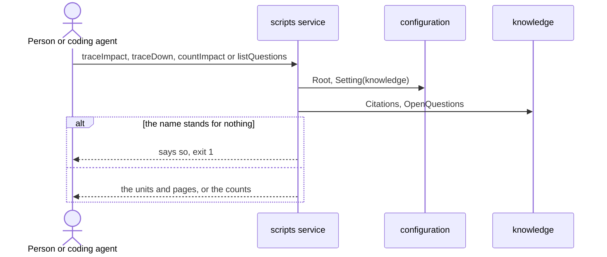

# Flow: Trace a change

A person, or a coding agent, sees what a change affects before making it, and
what a piece of knowledge relies on before building it.

- Crosses: [configuration](../artifacts/configuration/README.md) and
  [knowledge](../artifacts/knowledge/README.md), served by the `scripts`
  service.
- Contract: `traceImpact`, `traceDown`, `countImpact` and `listQuestions` in
  the [knowledge contract](../artifacts/knowledge/openapi.yaml).
- Trigger: a person or a coding agent is about to change, or to build, a part
  of the knowledge.
- Outcome: the person knows every unit and page a change affects, or relies
  on, and which open questions hold a goal.

## Steps

1. The person runs `traceImpact` with the name of what they will change: a
   knowledge ID, an operation, a page or a field. The `scripts` service finds
   the root and the knowledge folder (CFG-1, CFG-2), reads the citations
   (KN-17), resolves the name (KN-10) and lists what a change affects (KN-8).
2. Before building a criterion, a scenario or a page, the person runs
   `traceDown` with its name. The `scripts` service lists what it relies on
   (KN-9).
3. To compare goals, or to choose where a change is cheapest, the person runs
   `countImpact`. The `scripts` service counts the size of each goal and the
   blast radius of each requirement, rule and operation (KN-15).
4. Before a goal is built, the person runs `listQuestions`. The `scripts`
   service lists the open questions that hold each goal (KN-12).

## Scenarios

| ID | Given | When | Then | Covers |
| --- | --- | --- | --- | --- |
| F-TRACE-1 | A rule that two scenarios cite, and a criterion that cites one of them | The person runs `traceImpact` with the rule | It lists the rule, both scenarios, the criterion and their pages, by kind | KN-17, KN-8 |
| F-TRACE-3 | A schema property that one schema holds and one page names in backticks | The person runs `traceImpact` with the property | It lists what a change to that schema and to that page affects | KN-10, KN-8 |
| F-TRACE-4 | A goal key with three criteria | The person runs `traceImpact` with the key | It lists what a change to each of the three criteria affects | KN-10 |
| F-TRACE-5 | A criterion proven by two scenarios that cite rules of two artifacts | The person runs `traceDown` with the criterion | It lists the scenarios, the rules, the operations they name, and the pages of the flow and of both artifacts | KN-17, KN-9 |
| F-TRACE-6 | A name that no unit has, that is no prefix, page or property, and that no page names in backticks | The person runs `traceImpact`, `traceDown` or `countImpact` with it | It exits with 1 and says nothing in the knowledge cites the name | KN-10, SYS-3 |
| F-TRACE-7 | A knowledge folder with two goals | The person runs `countImpact` with no name | It prints the size of each goal, then the blast radius of each requirement, rule and operation, the largest first | KN-15 |
| F-TRACE-8 | A rule | The person runs `countImpact` with the rule | It prints what the rule relies on and what a change to it affects, as counts | KN-15 |
| F-TRACE-9 | A rule that no scenario cites | The person runs `countImpact` with no name | The rule shows 0 scenarios | KN-15 |
| F-TRACE-10 | An open question that names a rule one goal relies on, and one that names nothing in the knowledge | The person runs `listQuestions` | The first is listed under that goal only, the second under the questions that name nothing | KN-12 |
| F-TRACE-11 | Any workspace | The person runs `traceImpact`, `traceDown`, `countImpact` or `listQuestions` | No file of the workspace changes | SYS-4 |
| F-TRACE-12 | A criterion is proved by scenarios that cite local and shared Flow rules with artifact and system dependencies; a flow links to client-owned design outside the knowledge folder; an FR-shaped artifact rule is also defined outside the Flow-rule form | The person runs `traceImpact` on a Flow rule, `traceDown` on the criterion and `countImpact` on the criterion | Traces follow the rule's consumers up and its dependencies down, distinguish Flow rules from artifact rules and scenarios, and exclude the design link from dependencies; counts aggregate both rule types without adding scenarios or artifacts for Flow rules; a trace with no Flow rules has no Flow rules group | KN-17, KN-8, KN-9, KN-15, KN-13 |
| F-TRACE-13 | A scenario whose When names an operation and whose Covers names a rule, in contracts that cite no knowledge ID | The person runs `traceImpact` with the rule, then with the operation | The first lists the scenario, the operation, the schemas the operation uses and the criteria above them; the second lists the scenario and the criteria, and not the rule | KN-17, KN-8 |

Return to [flows](README.md).
