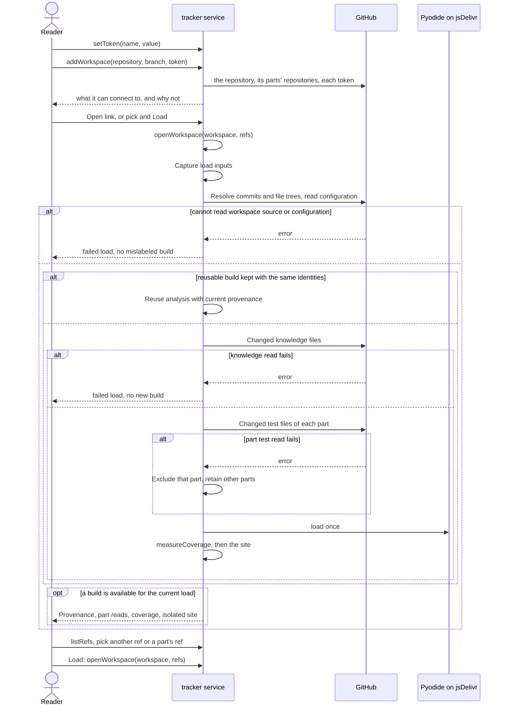

# Flow: View a workspace

A reader who does not read the repository opens the project tracker and sees,
for one workspace at one ref, the coverage of each goal and how its goals,
flows and artifacts link.

- Crosses: [tracker](../artifacts/tracker/README.md), served by the `tracker`
  service, and [configuration](../artifacts/configuration/README.md),
  [knowledge](../artifacts/knowledge/README.md) and
  [test](../artifacts/test/README.md), whose code of the `scripts` service the
  tracker runs in the browser.
- Contract: `openWorkspace`, `listRefs`, `setToken`,
  `addWorkspace`, `removeWorkspace`, `addFolder`, `checkSettings`,
  `changeConfiguration`, `restoreConfiguration`, `copyCloneScript`,
  `exportSettings` and `importSettings` in the
  [tracker contract](../artifacts/tracker/openapi.yaml), and
  `measureCoverage` in the
  [test contract](../artifacts/test/openapi.yaml).
- Trigger: a reader follows a link to the tracker, such as the one on the
  landing page (`openTracker`) or one a team sends with the workspace and the
  ref in it.
- Outcome: the reader sees the load's sources and part-read outcomes, the
  coverage of each goal, then the knowledge site; or the reason the workspace
  could not be read.

## Steps

1. Once, in the settings, the reader names each token needed with
   `setToken`, and adds each workspace with `addWorkspace`: a repository, a
   branch, and a token or none (TRK-6, TRK-7). The tracker checks the
   workspace, the repositories of the parts its configuration names and the
   tokens, and shows what it cannot connect to and why (TRK-11); the reader picks a token for a
   private part there. `checkSettings` checks them again. To try another
   configuration, the reader changes it with `changeConfiguration`; the
   tracker validates it and uses it in place of the workspace's until
   `restoreConfiguration` (TRK-12). To read a workspace from disk instead,
   the reader copies its clone script with `copyCloneScript`, runs it, and
   adds the clone with `addFolder` (TRK-13, TRK-8).
2. The page opens and calls `openWorkspace` with the workspace and the ref
   the address names, or the ones chosen before, or the repository of the
   framework (TRK-1, TRK-7).
3. The tracker captures the load's inputs (TRK-15). For a repository, it
   asks GitHub for the commit of the ref and its file tree, and downloads
   the configuration, the knowledge folder and the files it does not keep
   yet (TRK-2, TRK-5). It reads the parts of that effective configuration
   (TRK-4, CFG-6). Each repository is read with the captured token selection,
   if any (TRK-6, TRK-15). For a folder added with `addFolder`, it reads the
   working-copy files (TRK-8). Each part gets its read outcome (TRK-16).
4. The tracker loads Pyodide from jsDelivr once per page load, and runs the
   scripts of the framework on the files: the coverage as `measureCoverage`
   prints it, then the knowledge site (TRK-2, TRK-3). It reuses or keeps a
   build only under TRK-5.
5. The page publishes the current load's result under TRK-15. It shows the
   coverage, its sentence on what coverage means, the source identities and
   part-read outcomes (TRK-3, TRK-16, TRK-17). It displays the knowledge site
   within the isolation boundary (TRK-14, SYS-7), with classified knowledge
   kinds and dependencies (KN-13, KN-17). Each part, repository or
   file it could not read is listed with the reason (TRK-9).
6. The reader picks another ref, or the ref of a part, from the lists that
   `listRefs` gives, and calls `openWorkspace` again with Load. Picking alone
   builds nothing (TRK-1); a load downloads only what changed (TRK-5). The
   tracker applies a ref-list response only to its current request context
   (TRK-15).
7. The reader moves the settings to another browser with `exportSettings` and
   `importSettings` (TRK-7).

GitHub calls do not write. Repeating a load resolves the refs again, so a
branch or tag that moved can produce a different build (TRK-5, TRK-17).
When a test read fails, the tracker reports it and builds with the other
parts (TRK-9, TRK-16).

## Scenarios

| ID | Given | When | Then | Covers |
| --- | --- | --- | --- | --- |
| F-VIEW-1 | An address that names a public workspace and its branch `main` | The reader opens it, which calls `openWorkspace` | The page shows that workspace at `main`: first one coverage line for each goal with the sentence on what coverage means, then the knowledge site | TRK-1, TRK-2, TRK-3 |
| F-VIEW-2 | An address that names no workspace, and no settings in the browser | The reader opens it, which calls `openWorkspace` | The page shows the repository of the framework at its default branch | TRK-1 |
| F-VIEW-3 | A workspace shown at `main`, a branch `feature/renew` that changes one flow, and a part whose tests are in another repository with a branch `feature/renew` | The reader calls `listRefs` for the workspace and for the part, picks `feature/renew` for both, then calls `openWorkspace` with Load | The branches list `main` first; the page shows the knowledge of `feature/renew`, with the changed flow, and the coverage with the part's tests at `feature/renew` | TRK-1, TRK-2, TRK-4 |
| F-VIEW-4 | A workspace loaded at `main`, then at `feature/renew` | The reader picks `main` again, then calls `openWorkspace` with Load, then calls it again after one knowledge file changed on `main` | Picking reads nothing; the first load reads the commit and the file tree only and shows the kept build of `main`; the second downloads only the changed file and builds again | TRK-1, TRK-5 |
| F-VIEW-5 | A workspace and the tests of its parts | The reader calls `openWorkspace`, and a person runs `measureCoverage` with the same effective configuration and included files at the resolved workspace and part commits | The coverage lines are the same | TRK-3, TRK-4, TRK-17, TST-4 |
| F-VIEW-6 | A part whose tests setting names a repository, a test there that fails and names a rule, and a reader who picks `feature/renew` for that part | The reader calls `openWorkspace` | The test files come from that repository at `feature/renew`; the rule counts as covered; no test runs and no file changes | TRK-2, TRK-4, CFG-6, TST-3, SYS-4, SYS-6 |
| F-VIEW-7 | A private workspace, and a token named `team` set with `setToken` | The reader calls `addWorkspace` with the repository and `team`, then `exportSettings`, then closes the tab | The workspace builds; the token was sent only to `api.github.com`; the exported file names `team` and holds no token value; a new tab has no token value, and the workspace there asks for `team` again | TRK-6, TRK-7 |
| F-VIEW-8 | A folder with the workspace, a part cloned in it, a test file under `node_modules`, and `.git/HEAD` naming `feature/renew` | The reader calls `addFolder` with the folder | The page identifies working-copy files with `feature/renew` as context, shows the coverage of the part's tests, and does not read the file under `node_modules` | TRK-8, TRK-17, CFG-4 |
| F-VIEW-9 | A workspace with two parts whose tests name repositories, one of which the token cannot read | The reader calls `openWorkspace` | The page names that part and the reason, and shows the coverage and the site with the other part's tests | TRK-4, TRK-9 |
| F-VIEW-10 | A browser 360 px wide, on a system that uses a dark theme | The reader calls `openWorkspace` | The page stays light and needs no horizontal scrolling | TRK-10 |
| F-VIEW-11 | Settings of an older version in the browser, and a settings file of a newer version | The page loads, then the reader calls `importSettings` with the file | The older settings are migrated and stored; the newer file is shown with a warning and not stored | TRK-7 |
| F-VIEW-12 | A public workspace with a part whose tests setting names a private repository, and no token picked for that part | The reader calls `openWorkspace` | Above the coverage, the page names the part and says that it needs a token; the coverage leaves out its tests; the rest builds | TRK-3, TRK-6, TRK-9 |
| F-VIEW-13 | A token named `old` that GitHub refuses, and a repository that does not exist | The reader calls `checkSettings`, then `addWorkspace` with that repository, then `removeWorkspace` | The token `old` shows as refused; the new workspace shows as not found; after the removal it is gone from the settings and the workspace picker | TRK-11, TRK-7 |
| F-VIEW-14 | A workspace, and a changed configuration that is not valid JSON, then one whose `services` is a list | The reader calls `changeConfiguration` with each | Each is reported, the first with the line where it fails and the second with the key; the tracker builds with neither and keeps the last valid one | TRK-12, CFG-2 |
| F-VIEW-15 | A workspace whose configuration was changed in the tracker to add a part with a tests folder | The reader calls `openWorkspace`, then `restoreConfiguration`, then `openWorkspace` again | The first build includes the added part and identifies the override; restoring does not relabel it; the next build uses the workspace configuration; the workspace has no new commit | TRK-12, TRK-4, TRK-15, TRK-17 |
| F-VIEW-16 | A workspace picked at `main`, a part whose tests setting names a private repository and folder `services/lending`, `feature/renew` picked for it, and a token picked for it | The reader calls `copyCloneScript`, runs the script in an empty folder, then calls `addFolder` with the clone | The script clones the workspace at `main` and the part at `feature/renew` into `services/lending`, and holds no token; the folder builds with the part's tests | TRK-13, TRK-6, TRK-8, CFG-6 |
| F-VIEW-17 | A load in progress with a selected workspace, refs, configuration override and tokens | The reader calls `openWorkspace`, then changes those selections and calls `setToken` and `restoreConfiguration` before reads finish | The load reads only with its captured inputs and credential values; any result shown keeps those input identities and its override label; changed selections need another Load and no token value appears in the result | TRK-1, TRK-6, TRK-12, TRK-15, TRK-17 |
| F-VIEW-18 | A later load has started while asynchronous work from an earlier load remains | Work from the earlier `openWorkspace` completes after the later load | The obsolete success or failure cannot replace the later result, status, warnings or part controls | TRK-15 |
| F-VIEW-19 | Two workspaces or configurations have a part with the same name but different repositories or token selections, and an old ref-list request is delayed | The reader calls `listRefs`, changes the selection, then calls `listRefs` for the new selection | Only the new request may populate the current ref choices; an older response cannot change the selected ref or the current part's options | TRK-1, TRK-15 |
| F-VIEW-20 | Two parts have test files, and one blob in the first part fails after another of its blobs was read | The reader calls `openWorkspace` | The first part is failed with its source and reason, none of its test files contributes, the second part is complete and contributes, and coverage visibly identifies the incomplete read | TRK-3, TRK-9, TRK-16 |
| F-VIEW-21 | A service with no tests setting, a client with the same name and a missing tests folder, a declared end-to-end tests folder with no matches, and another part with readable tests | The reader calls `openWorkspace`, then loads the same repository inputs again | The outcomes distinguish each configuration group and name; the first three are missing with distinct reasons and the fourth is complete; the configuration remains valid, missing tests are not called read failures, the coverage calculation is unchanged, and confirmed missing outcomes do not prevent reuse | TRK-2, TRK-3, TRK-5, TRK-16, CFG-4, TST-4 |
| F-VIEW-22 | A kept build and a new workspace or part commit with the same short SHA prefix but a different full SHA | The reader calls `openWorkspace` at the new commit | The tracker does not reuse the old build and exposes the full resolved commits and requested refs of the workspace and repository parts | TRK-5, TRK-17 |
| F-VIEW-23 | A part failed to read in a previous load, and its files are now readable at the same commits | The reader calls `openWorkspace` again | The failed read is retried, the recovered part is complete and contributes its tests, and the result carries no warning from the earlier failure | TRK-3, TRK-5, TRK-9, TRK-16 |
| F-VIEW-24 | Workspace configuration, knowledge text, paths or diagrams contain script-closing text, attribute quotes, event markup, script URLs or remote resource URLs | The reader calls `openWorkspace`, opens the same generated HTML both embedded and standalone, and uses goal selection, details and diagrams | In both contexts, content remains data, no workspace content executes as page code or initiates a request to a supplied destination, controls remain usable, and diagrams that cannot render retain readable source | SYS-7, TRK-14 |
| F-VIEW-25 | A tracker tab holds a token and displays a site with diagrams and expanding controls | The reader calls `openWorkspace`, opens goal details and diagram navigation, then loads with diagram libraries unavailable | The frame cannot read tracker storage or tokens, access its document or navigate it; valid frame sizing keeps controls visible, stale or unrelated sizing messages are ignored, and unavailable diagrams retain readable source | SYS-7, TRK-10, TRK-14 |
| F-VIEW-26 | A folder's files differ from its Git commit, or change while the folder is being read | The reader calls `addFolder`, then `openWorkspace` again | Each result identifies the folder as its working-copy source, its effective configuration and analyzer; a Git label is context only, no atomic snapshot is claimed, and the second load rereads the folder | TRK-8, TRK-15, TRK-17 |
| F-VIEW-27 | A workspace's loaded configuration changes its parts between refs, and the reader has not opened settings | The reader calls `openWorkspace` at each ref | The parts and their sources follow each load's effective configuration, including added or removed parts; stale settings or ref-list responses cannot restore the former parts | TRK-2, TRK-4, TRK-15 |
| F-VIEW-28 | A complete kept build with unchanged repository commits, followed by a different effective configuration or analyzer identity | The reader calls `changeConfiguration` when applicable, then `openWorkspace` | The changed input produces a new analysis with its own configuration and analyzer identities; an older kept build cannot supply the result or override label | TRK-5, TRK-12, TRK-15, TRK-17 |
| F-VIEW-29 | A previous build is shown, and a new load cannot read its workspace configuration or fails after reading only some knowledge files | The reader calls `openWorkspace`, then calls it again with the same inputs after the read failure is resolved | The failed load shows its reason and no new build; a retained older build keeps its original source, configuration and analyzer identities; other workspaces remain usable; the later load retries the failed read and publishes the recovered result without the previous failure warning | TRK-5, TRK-9, TRK-15, TRK-17 |
| F-VIEW-31 | A workspace has local and shared Flow rules, scenarios that cite them, an FR-shaped artifact definition outside that form, and a link to client-owned design outside the knowledge folder | The reader calls `openWorkspace` and inspects the knowledge site and coverage | The site counts the classified Flow rules apart from scenarios and artifact rules; the design link adds no dependency or execution evidence; coverage aggregates the rule types and does not count a tested rule as a tested scenario | KN-17, KN-13, TST-3, TST-4, TRK-2, TRK-3 |
| F-VIEW-32 | The sample's Borrow a book goal | The reader calls `openWorkspace`, analyzes the goal and plays its story | The story shows the goal, its 2 flows, the rules that `traceDown` lists for G-BORROW grouped by flow, and the artifacts book, member and notice; each block opens its source page in the side panel as escaped text, with its diagrams and the row of a rule marked, and a link to the file | KN-16, SYS-7 |

## Open questions

- Whether the tracker shows the API coverage of the site, which reads the
  routes of each service from its code (TRK-2).

Return to [flows](README.md).
