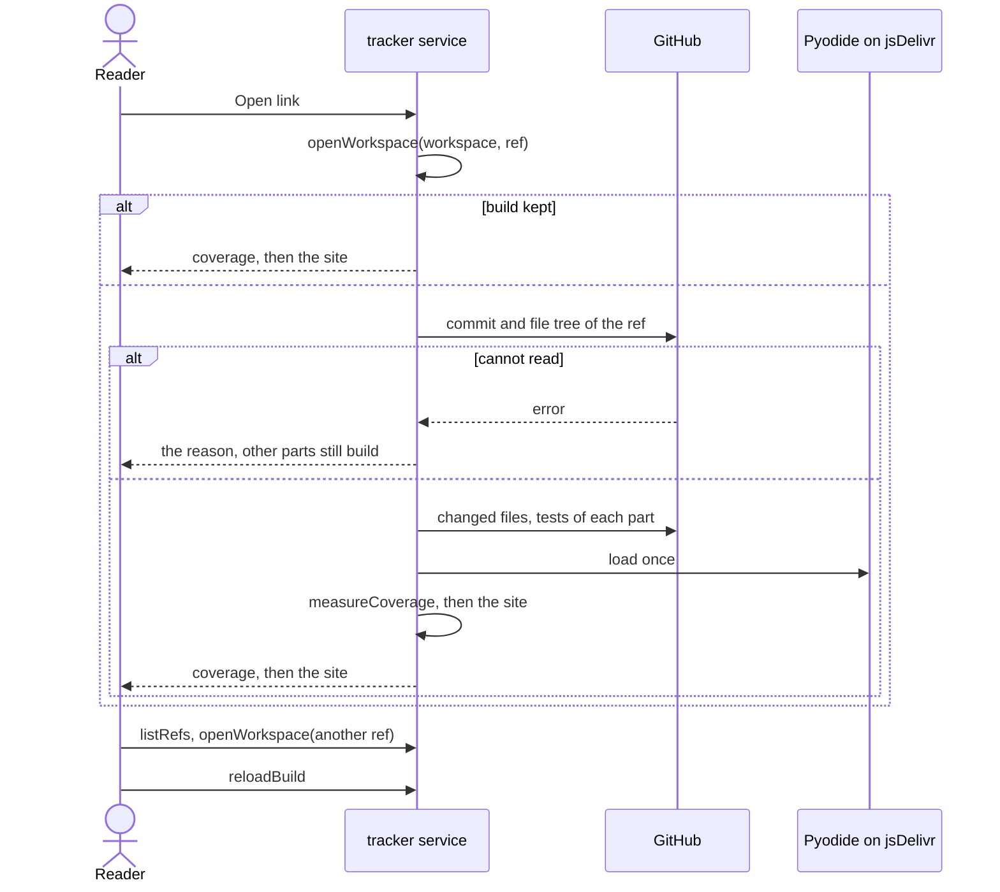

# Flow: View a workspace

A reader who does not read the repository opens the project tracker and sees,
for one workspace at one ref, the coverage of each goal and how its goals,
flows and artifacts link.

- Crosses: [tracker](../artifacts/tracker/README.md), served by the `tracker`
  service, and [configuration](../artifacts/configuration/README.md),
  [knowledge](../artifacts/knowledge/README.md) and
  [test](../artifacts/test/README.md), whose code of the `scripts` service the
  tracker runs in the browser.
- Contract: `openWorkspace`, `listRefs`, `reloadBuild`, `setToken`,
  `addFolder`, `exportSettings` and `importSettings` in the
  [tracker contract](../artifacts/tracker/openapi.yaml), and
  `measureCoverage` in the
  [measure coverage contract](measure-coverage.openapi.yaml).
- Trigger: a reader follows a link to the tracker, such as the one on the
  landing page (`openTracker`) or one a team sends with the workspace and the
  ref in it.
- Outcome: the reader sees the coverage of each goal, then the knowledge
  site, of the workspace at the ref; or the reason a part could not be read.

## Steps

1. The page opens and calls `openWorkspace` with the workspace and the ref
   the address names, or the ones chosen before, or the repository of the
   framework (TRK-1, TRK-7).
2. For a repository, the tracker asks GitHub for the commit of the ref and
   its file tree, and downloads the configuration, the knowledge folder and
   the files it does not keep yet (TRK-2, TRK-5). For each part whose tests
   setting names a repository (CFG-6), it reads that repository's test files
   the same way (TRK-4). A private repository needs the token of its owner,
   set with `setToken` (TRK-6). For a folder added with `addFolder`, the
   tracker reads the files on disk (TRK-8).
3. The tracker loads Pyodide from jsDelivr once per page load, and runs the
   scripts of the framework on the files: the coverage as `measureCoverage`
   prints it, then the knowledge site (TRK-2, TRK-3). It keeps the build for
   the workspace and the ref (TRK-5).
4. The page shows the coverage, its sentence on what coverage means, and the
   knowledge site (TRK-3). Each part, repository or file it could not read is
   listed with the reason (TRK-9).
5. The reader picks another ref with `listRefs` and `openWorkspace`, or reads
   the same ref again with `reloadBuild` (TRK-5).
6. The reader moves the settings to another browser with `exportSettings` and
   `importSettings` (TRK-7).

GitHub is called with no write, so a call that repeats gives the same result.
When a call fails, the tracker reports it and builds what it could read
(TRK-9).

## Scenarios

| ID | Given | When | Then | Covers |
| --- | --- | --- | --- | --- |
| F-VIEW-1 | An address that names a public workspace and its branch `main` | The reader opens it, which calls `openWorkspace` | The page shows that workspace at `main`: first one coverage line for each goal with the sentence on what coverage means, then the knowledge site | TRK-1, TRK-2, TRK-3 |
| F-VIEW-2 | An address that names no workspace, and no settings in the browser | The reader opens it, which calls `openWorkspace` | The page shows the repository of the framework at its default branch | TRK-1 |
| F-VIEW-3 | A workspace shown at `main`, and a branch `feature/renew` that changes one flow | The reader calls `listRefs`, then `openWorkspace` with `feature/renew` | The branches list `main` first; the page shows the knowledge of `feature/renew`, with the changed flow | TRK-1, TRK-2 |
| F-VIEW-4 | A workspace built at `main` and then at `feature/renew` | The reader calls `openWorkspace` with `main` again, then `reloadBuild` | The first shows `main` with no call to GitHub; the reload asks for the commit and the file tree, and downloads only the files whose blob SHA changed | TRK-5 |
| F-VIEW-5 | A workspace and the tests of its parts | The reader calls `openWorkspace`, and a person runs `measureCoverage` in a clone of it at the same ref, with the same parts cloned | The coverage lines are the same | TRK-3, TRK-4, TST-4 |
| F-VIEW-6 | A part whose tests setting names a repository, a test there that fails and names a rule, and a reader who picks `feature/renew` for that part | The reader calls `openWorkspace` | The test files come from that repository at `feature/renew`; the rule counts as covered; no test runs and no file changes | TRK-2, TRK-4, CFG-6, TST-3, SYS-4, SYS-6 |
| F-VIEW-7 | A private repository, and a read-only token set for its owner with `setToken` | The reader calls `openWorkspace`, then `exportSettings`, then closes the tab | The workspace builds; the token was sent only to `api.github.com`; the exported file holds no token; a new tab has no token | TRK-6, TRK-7 |
| F-VIEW-8 | A folder with the workspace, a part cloned in it, a test file under `node_modules`, and `.git/HEAD` naming `feature/renew` | The reader calls `addFolder` with the folder | The page shows the folder's workspace at `feature/renew` with the coverage of the part's tests, and does not read the file under `node_modules` | TRK-8, CFG-4 |
| F-VIEW-9 | A workspace with two parts whose tests name repositories, one of which the token cannot read | The reader calls `openWorkspace` | The page names that part and the reason, and shows the coverage and the site with the other part's tests | TRK-4, TRK-9 |
| F-VIEW-10 | A browser 360 px wide, on a system that uses a dark theme | The reader calls `openWorkspace` | The page stays light and needs no horizontal scrolling | TRK-10 |
| F-VIEW-11 | Settings of an older version in the browser, and a settings file of a newer version | The page loads, then the reader calls `importSettings` with the file | The older settings are migrated and stored; the newer file is shown with a warning and not stored | TRK-7 |

## Open questions

- Whether the tracker shows the API coverage of the site, which reads the
  routes of each service from its code (TRK-2).

Return to [flows](README.md).
