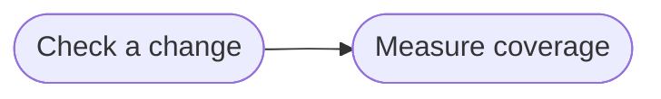

# Goal: Cover the knowledge with tests

## Need

The team knows which rules, scenarios and criteria the tests of its parts
name, and which ones no test names, so that it can see what is not yet proved
and test that first. Coverage tells only that a test names an ID, never that
the test is right.

- Actor: Solution architect and Implementer ([context](../system/context.md)).
- Follows: SYS-4, SYS-6 ([requirements](../system/requirements.md)).

## Success criteria

| ID | Criterion | Proven by |
| --- | --- | --- |
| G-COVER-1 | For each goal, a person sees how many of the criteria, scenarios and rules it relies on a test names, and which ones no test names. | F-COVER-1, F-COVER-3, F-COVER-11 |
| G-COVER-2 | Coverage counts only that a test names an ID: a test that fails, or that proves nothing, still counts, and no test is run. | F-COVER-2, F-COVER-9 |
| G-COVER-3 | Coverage reads the tests of every part that the configuration names and that exists, or one folder the person gives, and says so when it has no test to read. | F-COVER-4, F-COVER-5, F-COVER-6, F-COVER-10 |
| G-COVER-4 | A person sees the requirements, rules, operations and schemas that a change would break most and that are proved least. | F-COVER-7, F-COVER-8 |
| G-COVER-5 | Every ID that coverage counts as tested is an ID the knowledge holds. | F-CHECK-13, F-CHECK-14 |

## Flows

1. [Check a change](../flows/check-change.md)
2. [Measure coverage](../flows/measure-coverage.md)

Return to [goals](README.md).
