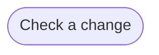

# Goal: Gate the default branch

## Need

Broken knowledge and tests that name knowledge that does not exist never reach
the default branch, so that every page, ID and test on it can be trusted
without a second look.

- Actor: Coding agent and Implementer, who write changes; Solution architect,
  who reviews them ([context](../system/context.md)).
- Follows: SYS-2, SYS-3, SYS-4, SYS-6 ([requirements](../system/requirements.md)).
- Constraint: the CI of the workspace runs the checks on each pull request
  into the default branch, and a failed check stops the merge
  ([check the docs](../../governances/artifact-driven/runbooks/check.md)).

## Success criteria

| ID | Criterion | Proven by |
| --- | --- | --- |
| G-GATE-1 | A folder without a README fails the gate. | F-CHECK-2, F-CHECK-3 |
| G-GATE-2 | A broken link or heading anchor fails the gate. | F-CHECK-5, F-CHECK-6, F-CHECK-22 |
| G-GATE-3 | A knowledge ID that is cited and not defined, defined twice, or withdrawn and still cited fails the gate. | F-CHECK-7, F-CHECK-8, F-CHECK-9 |
| G-GATE-4 | A layer that cites a layer above it fails the gate. | F-CHECK-10 |
| G-GATE-5 | A scenario that names nothing that starts it, or an operation, trigger or command that no scenario names, fails the gate. | F-CHECK-11 |
| G-GATE-6 | A test that names a knowledge ID that does not exist, or a withdrawn one, fails the gate. | F-CHECK-13, F-CHECK-14, F-CHECK-15 |
| G-GATE-7 | A change that breaks no rule passes the gate, so the gate stops only broken changes. | F-CHECK-1, F-CHECK-4, F-CHECK-12, F-CHECK-16, F-CHECK-20, F-CHECK-23, F-CHECK-24, F-START-6 |
| G-GATE-8 | One run of a check lists every problem it finds, and running it changes nothing. | F-CHECK-17, F-CHECK-18, F-CHECK-19, F-CHECK-21 |

## Flows

1. [Check a change](../flows/check-change.md)

Return to [goals](README.md).
