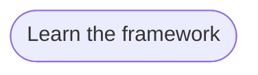

# Goal: Learn the framework

## Need

Stakeholders, solution architects, product owners and implementers can
understand the framework through one reading path: what it is, how its
knowledge fits together, how people and agents make a change, what its checks
prove, and how to start.

- Actor: Stakeholder, Solution architect, Product owner and Implementer
  ([context](../system/context.md)).
- Follows: SYS-8 ([requirements](../system/requirements.md)).

## Success criteria

| ID | Criterion | Proven by |
| --- | --- | --- |
| G-LEARN-1 | A reader understands the knowledge layers and their relationships through the sample, including where rules, contracts, client needs and tests belong. | F-LEARN-5, F-LEARN-29 |
| G-LEARN-2 | Withdrawn. The reading path does not use an animated story that the reader must stop. | — |
| G-LEARN-3 | A reader distinguishes IDs named in test files from passing runtime tests, and understands change impact as dependencies rather than a claim about cost or duration. | F-LEARN-4, F-LEARN-6, F-LEARN-24 |
| G-LEARN-4 | Withdrawn: moved to G-LEARN-9. | — |
| G-LEARN-5 | A reader creates, from the reading path, a workspace that holds the sample used in its examples. | F-LEARN-5, F-LEARN-8 |
| G-LEARN-6 | The reading path works on a phone, also with a dark system theme, and its explanations remain readable with no build or access to another host. | F-LEARN-10, F-LEARN-25 |
| G-LEARN-7 | Withdrawn: moved to G-LEARN-14. | — |
| G-LEARN-8 | Withdrawn: moved to G-LEARN-13. | — |
| G-LEARN-9 | A product owner and a solution architect can identify what they write, read and decide from a need to an artifact, find the diagrams and tests of each layer, and reach the project tracker from the reading path in one step. | F-LEARN-16, F-LEARN-17, F-LEARN-20, F-LEARN-25, F-LEARN-26 |
| G-LEARN-10 | Withdrawn. The how-we-work page names each known practice at the step that uses it; a separate list of practices added nothing. | — |
| G-LEARN-11 | A developer or agent operator learns how people and agents work together with Claude Code or Codex by following one sample change from the issue to the pull request, within the limits of the team. | F-LEARN-22, F-LEARN-23, F-LEARN-24 |
| G-LEARN-12 | A developer or agent operator gives one sample change to their own agent in a new workspace and judges its run against the governance. | F-LEARN-28 |
| G-LEARN-13 | A reader can find the framework resources for common team tasks, with examples supported by the sample. | F-LEARN-15 |
| G-LEARN-14 | A developer or agent operator can find the framework's parts and workspace files without leaving the reading path. | F-LEARN-12, F-LEARN-13 |
| G-LEARN-15 | A reader can choose a topic and read at their own pace, including with reduced motion, and can still reach the intended content through former reading-page URLs and hash links. | F-LEARN-29, F-LEARN-30 |

## Flows

1. [Learn the framework](../flows/learn-framework.md)

Return to [goals](README.md).
