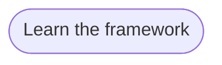

# Goal: Learn the framework

## Need

Stakeholders, solution architects and product owners who do not read the
repository understand, from one page, how a goal becomes flows, rules,
artifacts, clients and tests, what coverage and the size of a change mean,
and where to go next.

- Actor: Stakeholder, Solution architect and Product owner
  ([context](../system/context.md)).

## Success criteria

| ID | Criterion | Proven by |
| --- | --- | --- |
| G-LEARN-1 | A reader sees, in one story, a goal split into flows, rules, artifacts, clients and tests, with the names of the sample, and can ask what each block is. | F-LEARN-1, F-LEARN-5, F-LEARN-11 |
| G-LEARN-2 | A reader can stop the story at any step, and a reader who asks for reduced motion sees it without motion. | F-LEARN-2, F-LEARN-3 |
| G-LEARN-3 | A reader learns that the scan tells only which rules are in the product, not that they work, and that a change is measured by its size, never by its cost. | F-LEARN-2, F-LEARN-4, F-LEARN-6 |
| G-LEARN-4 | Withdrawn: moved to G-LEARN-9. | — |
| G-LEARN-5 | A reader creates, from the page, a workspace that holds the sample the story showed. | F-LEARN-5, F-LEARN-8 |
| G-LEARN-6 | The pages read on a phone, also when the phone uses a dark theme, and show their story with no build and with no other host to reach. | F-LEARN-9, F-LEARN-10, F-LEARN-19 |
| G-LEARN-7 | A developer or an agent operator learns, on one short page, what the framework turns the governance of Artifact Driven into, its parts, and what each workspace gets from them. | F-LEARN-12, F-LEARN-13, F-LEARN-14 |
| G-LEARN-8 | A reader sees, from situations of a team's day, which question each raises and what in the framework answers it, with an example they can check in the sample. | F-LEARN-15 |
| G-LEARN-9 | A product owner and a solution architect each see, on one page, what they write, read and decide at each step from a goal to an artifact, in the words of their own trade, with the diagram and the tests of each step, and reach the project tracker from the landing page in one step. | F-LEARN-16, F-LEARN-17, F-LEARN-18, F-LEARN-20 |
| G-LEARN-10 | A reader learns that the framework puts known practices of software development together and invents none, and sees where each one shows. | F-LEARN-21 |

## Flows

1. [Learn the framework](../flows/learn-framework.md)

Return to [goals](README.md).
