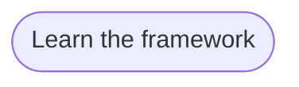

# Goal: Learn the framework

## Need

Stakeholders, solution architects and product owners who do not read the
repository understand, from one page, how a goal becomes flows, rules,
artifacts, clients and tests, what coverage and the size of a change mean,
and where to go next.

- Actor: Stakeholder, Solution architect and Product owner
  ([context](../system/context.md)).

## Success criteria

| ID | Criterion | Proven by |
| --- | --- | --- |
| G-LEARN-1 | A reader sees, in one story, a goal split into flows, rules, artifacts, clients and tests, with the names of the sample, and can ask what each block is. | F-LEARN-1, F-LEARN-5, F-LEARN-11 |
| G-LEARN-2 | A reader can stop the story at any step, and a reader who asks for reduced motion sees it without motion. | F-LEARN-2, F-LEARN-3 |
| G-LEARN-3 | A reader learns that the scan tells only which rules are in the product, not that they work, and that a change is measured by its size, never by its cost. | F-LEARN-2, F-LEARN-4, F-LEARN-6 |
| G-LEARN-4 | A stakeholder, a solution architect and a product owner each find their questions and the page that answers each, and reach the project tracker in one step. | F-LEARN-7 |
| G-LEARN-5 | A reader creates, from the page, a workspace that holds the sample the story showed. | F-LEARN-5, F-LEARN-8 |
| G-LEARN-6 | The page reads on a phone, also when the phone uses a dark theme, and shows its story with no build and with no other host to reach. | F-LEARN-9, F-LEARN-10 |

## Flows

1. [Learn the framework](../flows/learn-framework.md)

Return to [goals](README.md).
