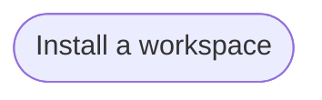

# Goal: Start a workspace

## Need

A team starts a project on Artifact Driven with one command, and gets a
working sample to learn the rules from, so that its first knowledge follows
the rules from the first day.

- Actor: Solution architect, who creates the workspace
  ([context](../system/context.md)).
- Follows: SYS-1, SYS-4, SYS-5 ([requirements](../system/requirements.md)).

## Success criteria

| ID | Criterion | Proven by |
| --- | --- | --- |
| G-START-1 | One command creates a workspace that holds the rules, the agent resources and the scripts of the framework, from the version the team chooses. | F-START-1, F-START-3, F-START-4, F-START-9, F-START-11 |
| G-START-2 | A new workspace holds a complete sample to learn from, and none of the framework's own knowledge or tests. | F-START-1, F-START-5 |
| G-START-3 | A new workspace passes the checks on their first run. | F-START-6 |
| G-START-4 | Creating a workspace never overwrites a folder and leaves nothing behind when it fails. | F-START-2, F-START-7, F-START-8, F-START-10 |

## Flows

1. [Install a workspace](../flows/install-workspace.md)

Return to [goals](README.md).
