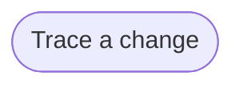

# Goal: Trace a change

## Need

Before a change, the team knows what it affects up to the goals, and what it
relies on down to the rules, so that nothing it touches is missed and no
change is made blind.

- Actor: Solution architect, Implementer and Coding agent
  ([context](../system/context.md)).
- Follows: SYS-2, SYS-4, SYS-6 ([requirements](../system/requirements.md)).

## Success criteria

| ID | Criterion | Proven by |
| --- | --- | --- |
| G-TRACE-1 | Before changing a requirement, a rule, an operation or a field, a person sees every criterion, scenario, operation, schema, client need and page that the change affects. | F-TRACE-1, F-TRACE-2, F-TRACE-3, F-TRACE-4 |
| G-TRACE-2 | Before building a criterion, a scenario or a page, a person sees every scenario, rule, operation and page it relies on. | F-TRACE-5 |
| G-TRACE-3 | A person sees the size of each goal, and which requirements, rules and operations a change would affect most. | F-TRACE-7, F-TRACE-8, F-TRACE-9 |
| G-TRACE-4 | A person sees which open questions hold a goal. | F-TRACE-10 |
| G-TRACE-5 | A name the knowledge does not hold is reported as unknown, never as a change that affects nothing. Tracing changes no file. | F-TRACE-6, F-TRACE-11 |

## Flows

1. [Trace a change](../flows/trace-change.md)

Return to [goals](README.md).
