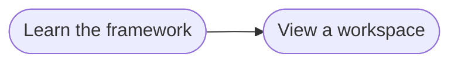

# Goal: Follow a project in the browser

## Need

Stakeholders, product owners and solution architects who do not read the
repository follow a project from a link: for each goal, how much of what it
relies on tests name, and how its flows and artifacts link, at any branch,
tag or commit. They install, clone and run nothing.

- Actor: Stakeholder, Product owner and Solution architect
  ([context](../system/context.md)).
- Follows: SYS-1, SYS-4, SYS-6 ([requirements](../system/requirements.md)).

## Success criteria

| ID | Criterion | Proven by |
| --- | --- | --- |
| G-VIEW-1 | A reader opens a link to the project tracker and sees, first, the coverage of each goal of the workspace, then how its goals, flows and artifacts link, with nothing to install, clone or run. | F-VIEW-1, F-VIEW-2 |
| G-VIEW-2 | A reader picks a workspace and any branch, tag or commit of it, and sees the knowledge and coverage of that ref. Going back to a ref already shown reads nothing again. | F-VIEW-3, F-VIEW-4, F-VIEW-11 |
| G-VIEW-3 | The coverage a reader sees is the coverage `measureCoverage` prints for the same knowledge and tests, and the page says that it counts only the IDs a test names. | F-VIEW-5, F-VIEW-6 |
| G-VIEW-4 | A reader reads a private repository with a read-only token, which leaves the browser only to GitHub and is gone when the tab closes. | F-VIEW-7 |
| G-VIEW-5 | A solution architect sees a workspace from a folder on their computer, with the parts cloned in it. | F-VIEW-8 |
| G-VIEW-6 | A repository, ref or folder that cannot be read is reported with the reason, and the rest of the page keeps working. | F-VIEW-9 |
| G-VIEW-7 | The page reads on a phone, also when the phone uses a dark theme. | F-VIEW-10 |

## Flows

1. [Learn the framework](../flows/learn-framework.md)
2. [View a workspace](../flows/view-workspace.md)

Return to [goals](README.md).
