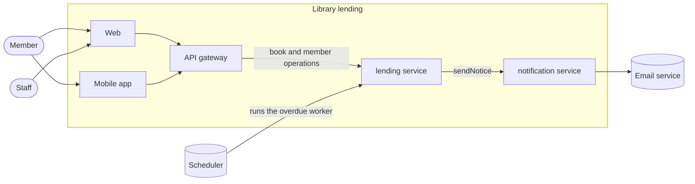

# Context

The library lending product lets members borrow books from a library and
return them, and lets staff look after the collection. It is two services
behind an API gateway, and two clients.

## Actors

| Actor | Uses |
| --- | --- |
| Member | Web, mobile app: find, borrow and return books |
| Staff | Web: add and withdraw books |

## Services

Each service serves the artifacts the
[domain map](../../architecture/domain-map.md) gives it, and has its own
database. The owner of each service is in
[services](../../../services/README.md).

| Service | Holds |
| --- | --- |
| `lending` | The API and the overdue worker |
| `notification` | Sends each message to a member once, by email |

The API gateway routes each client call to the service that serves its
operation. Calls between services do not go through it.

## Clients

| Client | Holds |
| --- | --- |
| Web | The browser client for members and staff |
| Mobile app | The client for members |

## Supported client versions

The oldest version of each client that SYS-4 and SYS-6
([requirements](requirements.md#released-client-versions)) still protect.

| Client | Oldest supported version |
| --- | --- |
| Web | The deployed build only |
| Mobile app | 2.0 |

## External systems

| System | Used for |
| --- | --- |
| Scheduler | Runs a worker of a service at a set time, such as the daily overdue check |
| Email service | Sends the emails of the `notification` service |

Return to [system](README.md).
