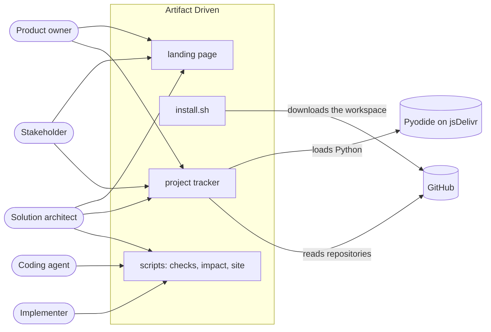

# Context

Artifact Driven lets a team build software from knowledge: goals, flows and
artifacts with IDs, which scripts check and trace, and which tests name. It is
a set of rules, a workspace a project installs, and the tools that read the
knowledge.

## Actors

| Actor | Uses |
| --- | --- |
| Solution architect | Writes and reviews the knowledge; reads impact and coverage across workspaces |
| Implementer | Builds a service or a client from the knowledge; names knowledge IDs in tests |
| Coding agent | Writes knowledge and code by the runbooks, and runs the checks |
| Stakeholder | Follows a project that a team, often another company, builds: its flows, its coverage and the size of a change |
| Product owner | Writes the goals and their success criteria, and approves them |

## Parts

| Part | Holds |
| --- | --- |
| Landing page (`index.html`) | The story of how a goal becomes flows, rules, artifacts, clients and tests, for readers who do not read the repository |
| `install.sh` | Creates a workspace from the shared files and the sample |
| `scripts` | The structure, docs and test checks, impact analysis and the knowledge site |
| Project tracker (`tracker/index.html`) | The coverage and the knowledge site of a workspace at any ref, in the browser, for readers who do not read the repository |

## Supported client versions

A workspace runs the scripts it installed. A new version of the framework does
not change a workspace until the workspace takes it.

Return to [system](README.md).
